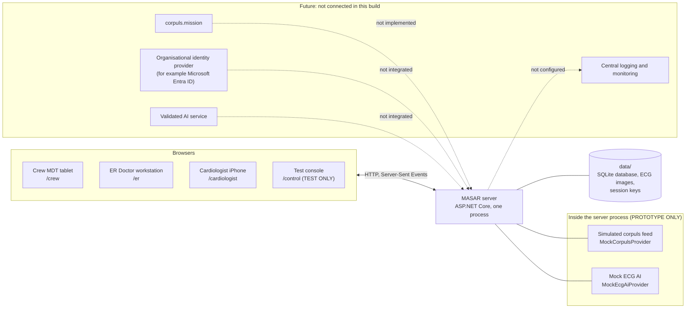
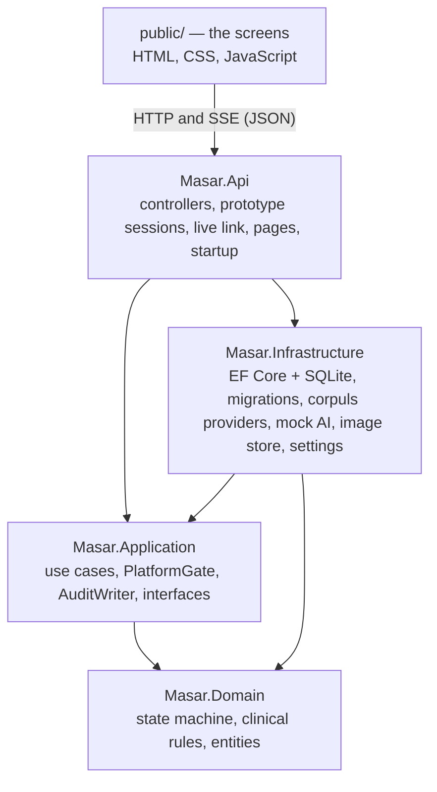
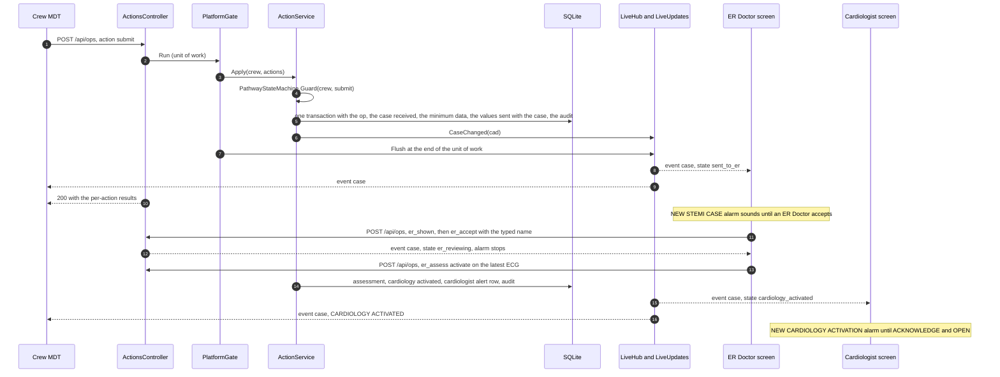
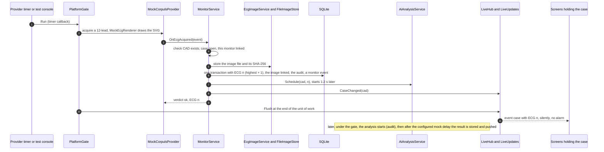

# Architecture · MASAR STEMI Coordination Platform 0.7.0

> **PROTOTYPE · FICTIONAL TEST DATA ONLY.** This describes the prototype as built, not a production system. The corpuls
> feed and the ECG AI are simulations, and the clinician identification is a typed name (see
> [handover.md](handover.md#production-readiness-labels)).
>
> **Update these diagrams whenever a major component changes** (a new project, provider, integration, background
> process or external system).

Related: [handover.md](handover.md) · [api.md](api.md) · [clinical-workflow.md](clinical-workflow.md) ·
[database.md](database.md) · [configuration.md](configuration.md) · [security.md](security.md) ·
[corpuls-integration.md](corpuls-integration.md) · [adr/0001-aspnet-core-backend.md](adr/0001-aspnet-core-backend.md)

---

## 1. System context



- **One server process** serves every screen (static HTML, CSS, JavaScript), the HTTP API, the live event stream and
  the stored ECG images, and holds all data in one SQLite file plus an image folder.
- **The screens** are browsers on the crew's tablet, the ER Doctor's workstation, the Cardiologist's phone and a test
  console. They talk to the server only through HTTP (actions, pages) and Server-Sent Events (updates).
- **The simulated corpuls feed and the mock AI run inside the server process.** The application makes no outbound
  network call. corpuls.mission, an identity provider, a real AI service and central logging are future integrations;
  none exists in this build.

## 2. The solution and its layers



| Project | Responsibility | May reference |
|---|---|---|
| `src/Masar.Domain` | The STEMI pathway state machine (`Pathway/PathwayStateMachine.cs`), the states (`PathwayStates.cs`), the three closures (`PathwayClosure.cs`), the facts a state is derived from (`CaseFacts.cs`), the clinical rules (`Rules/`), and the entities, one class per table (`Entities/`). | nothing (pure C#) |
| `src/Masar.Application` | The use cases and their orchestration: `Cases/` (create, correct, discard, open, complete, read, the case record), `Actions/ActionService.cs` (every clinical action), `Monitoring/` (the corpuls contract and `MonitorService`), `Ai/AiAnalysisService.cs`, `Simulation/` (TEST ONLY), `Common/` (`PlatformGate`, `AuditWriter`, `Actor`, transactions, JSON helpers), and the interfaces the outer layers implement (`Abstractions/`). | Domain, EF Core |
| `src/Masar.Infrastructure` | `Persistence/` (`MasarDbContext`, migrations, `DatabaseInitializer`, `SettingsStore`), `Corpuls/` (the providers and the synthetic ECG drawing), `Ai/MockEcgAiProvider.cs`, `Storage/FileImageStore.cs`, `Identity/CrewTestUserSeeder.cs`, the options classes, and `DependencyInjection.cs`. | Application, Domain |
| `src/Masar.Api` | The ASP.NET Core host: `Program.cs` (composition root), `Controllers/`, `Contracts/` (request and response bodies), `Security/` (prototype sessions), `Live/` (Server-Sent Events), `Hosting/` (startup tasks, banner, version, screens' files), `Configuration/`. | everything |
| `public/` | The screens. No build step; served as static files. | the HTTP API only |

**Rules that keep the layering clean:**

- Clinical rules live in `Masar.Domain` and are applied by `Masar.Application`. Controllers translate HTTP to a use case
  and back; they decide nothing clinical. The screens decide nothing either: they display the record and send actions.
- `Masar.Application` defines what it needs from the outside as interfaces (`IMasarDbContext`, `IEcgAiProvider`,
  `IImageStore`, `ISettingsStore`, `ILiveNotifier`, `ICorpulsProvider`); `Masar.Infrastructure` and `Masar.Api`
  implement them. A provider can be replaced without touching the use cases.
- Simulated and test-only code is kept apart and labelled: `Masar.Infrastructure/Corpuls/Mock*`,
  `Masar.Infrastructure/Ai/Mock*`, `Masar.Application/Simulation/`, `ICorpulsSimulator`, the test console controller.
- Services are registered as singletons (`Masar.Application/DependencyInjection.cs`,
  `Masar.Infrastructure/DependencyInjection.cs`): they hold no per-request state; every change runs through the one
  `PlatformGate`.

## 3. Request processing

The pipeline (`src/Masar.Api/Program.cs`), in order:

1. **Response headers** on every answer: `Cache-Control: no-store` unless the endpoint set its own,
   `X-Content-Type-Options: nosniff`, `Referrer-Policy: no-referrer`, `X-Frame-Options: DENY`.
2. **Static files** under `/assets/` from `Frontend:RootPath` (`Cache-Control: no-cache`, UTF-8 for text types).
3. **Authentication**: the prototype cookie schemes (`Security/ScreenSessions.cs`).
4. **Controllers.** Endpoints that need a screen's session carry `[ScreenSession]`
   (`Security/ScreenSessionAttribute.cs`): it resolves the `Actor` from the role the screen names (`X-Stemi-Role`, or
   `?role=`) and that role's session, or answers 401.
5. **Fallback**: anything else is 404 (`{"error":"Not found"}` under `/api`, plain text elsewhere).

JSON uses camelCase names (`JsonDefaults` in `Masar.Application/Common/JsonDefaults.cs`, the same options for the API
and the live stream). A request body that is not valid JSON is refused with 400 `{"error":"Bad JSON"}`; JSON bodies
are limited to 1 MB, ECG images to `Storage:MaxImageBytes`.

## 4. The unit of work: `PlatformGate`

`src/Masar.Application/Common/PlatformGate.cs`. Every change to the shared case record runs inside
`gate.Run(db => …)`:

- **One writer at a time.** The gate is a reentrant lock (`lock`). The rules depend on it: an ECG's number is "the
  case's highest ECG number + 1", every action is checked against the state it finds, and the screens, the corpuls feed
  and the AI service all change the same case.
- **One database context per change.** The outermost `Run` creates the context and disposes it at the end; nested
  `Run` calls (for example a corpuls event raised while an action runs, or the settings store) reuse it and see its
  uncommitted rows. A second connection would have to wait for the first writer forever (SQLite has one writer).
- **Synchronous inside.** Code inside the gate does not `await`: the lock belongs to the thread.
- **Write-through data access** (`Common/DbWrites.cs`, `Common/Transactions.cs`): queries do not track entities
  (`QueryTrackingBehavior.NoTracking`); inserts are saved at once (`db.Insert(…)`); updates use `ExecuteUpdate`. Every
  write is executed in order inside the current transaction, exactly as written in the code. `db.InTransaction(…)`
  opens a transaction or joins the one already open; on failure it is rolled back and the change tracker is cleared.
  Reads that must keep insertion order use SQL with `rowid` (`FromSql`), as the prototype did.
- **Completion handler.** When the outermost `Run` ends — while the lock is still held — the registered handlers run.
  The live link registers `LiveUpdates.Flush` (`Hosting/StartupTasks.cs`): every case changed by the unit of work is
  pushed to the screens at that point, so a screen never sees a half-made change and the push is queued before the
  HTTP answer of the change leaves. A failing handler is logged and never undoes the change.
- **Reads** for the screens run inside the gate too (short), so every record is consistent.

**Single-instance limitation.** The lock, the live connections and the simulated monitors are in-process: the
application must run as **one instance**. Running several instances would need: a database-level concurrency design
(row locking or optimistic concurrency on the case, or a single-writer queue) instead of the in-process lock; an
approved database server instead of SQLite; a live-link backplane so every instance can push to every screen (for
example SignalR with a backplane, which would change the live-link contract); a shared Data Protection key ring; and
a corpuls provider that does not keep its state in memory.

## 5. One case per CAD number, the same case on every screen

The CAD number (for example `20261004-0123-1`) is the case identifier: the primary key of `cases`, carried by every case
table. The crew enters it manually from the dispatch / MDT information; `Masar.Domain/Rules/CadNumber.cs` normalises
and checks it (`CAD#…`, `cad # …`, spaces, 13 digits → `20261004-0123-1`, shown as `CAD #20261004-0123-1`), and the
browser copy `public/shared/cad.js` gives instant feedback. A second case under the same number is never created
(CASE ALREADY EXISTS → correct the number, or OPEN EXISTING CASE).

There are no per-role copies: the crew, the ER Doctor and the Cardiologist read the same record
(`Cases/CaseRecordBuilder.cs`, documented field by field in [api.md](api.md#the-case-record)), pushed to each screen
that may see it. The server decides who may see what (`Cases/CaseVisibility.cs`):

| Screen | Sees live | Opens by CAD number (completed cases) |
|---|---|---|
| Crew MDT | its own unit's cases | its own unit's cases |
| ER Doctor | every case sent to the ER | every case sent to the ER |
| Cardiologist | only cases where cardiology was activated | activated cases; an ER-closed case only when searched for by CAD number (shown as CARDIOLOGY NOT ACTIVATED) |
| Test console | every case, including those taken off the screens | every case |

Several cases can be open at once (each screen has queues). The test console can take a case off the live screens
(`cases.active = 0`); that never closes its STEMI pathway.

## 6. The state machine

`Masar.Domain/Pathway/PathwayStateMachine.cs` derives the state from the stored record (`DeriveState`) and checks every
action against it before anything is stored (`Guard`). The full pathway, the labels and every refusal message are in
[clinical-workflow.md](clinical-workflow.md).

```
DRAFT → SENT TO ER → ER REVIEWING ─┬─ NOT SUSPICIOUS FOR STEMI (reason required) → ER REVIEW COMPLETED — CARDIOLOGY NOT ACTIVATED (closed)
                                   └─ ACTIVATE / UNCERTAIN → CARDIOLOGY ACTIVATED → CARDIOLOGIST REVIEWING ─┬─ CONFIRMED STEMI → COMPLETE → COMPLETED (closed)
                                                                                                              ├─ NOT STEMI → PATHWAY CLOSED (closed automatically)
                                                                                                              └─ REPEAT ECG REQUESTED → repeat ECG received → CARDIOLOGIST REVIEWING → …
```

| State | Derived from |
|---|---|
| `draft` | case created (when the crew links corpuls, so the monitor feed can attach), not yet sent (`server_received_at` empty); never shown to the ER or the Cardiologist |
| `sent_to_er` | received; no ER acceptance |
| `er_reviewing` | `er_accepted_at`; no activation |
| `er_closed` | closed with `closure_reason = ER Doctor assessment: NOT SUSPICIOUS FOR STEMI` |
| `cardiology_activated` | `cardiology_activated_at`; not acknowledged |
| `cardiologist_reviewing` | acknowledged; no decision yet (or the last decision is neither a confirmation nor a repeat request) |
| `repeat_requested` | last decision `repeat`, no ECG newer than the one it covered |
| `repeat_received` | last decision `repeat`, a newer ECG has arrived |
| `confirmed` | last decision `confirm`, not closed |
| `not_stemi_closed` | closed with `closure_reason = Cardiologist decision: NOT STEMI` |
| `completed` | closed with any other reason: the crew's COMPLETE STEMI PATHWAY (`closure_reason = STEMI pathway completed`) |

**Cases made before 0.5.0** went straight to the cardiologist. They have no ER fields and are read as already
cardiology-activated (`legacy: true` in the record, `CaseFacts.From`): they still open, and are acknowledged and decided
as before.

## 7. Two flows end to end

### 7.1 Crew SEND → ER alarm → ER assessment → Cardiologist alert



The Cardiologist is never alerted at SEND: only the ER Doctor's ACTIVATE or UNCERTAIN creates the cardiology alert.

### 7.2 A corpuls ECG arriving (simulated feed)



Vital-sign samples follow the same path without the AI: they update `cases.vitals_json`, add a history row only when
needed (each blood pressure measurement, explicit updates, about one routine sample a minute) and are pushed as the
small `monitor` event instead of the whole case. Routine samples are never audited.

## 8. The corpuls feed

The ECG and the vital signs come from the unit's corpuls monitor through a provider behind `ICorpulsProvider`
(`Masar.Application/Monitoring/CorpulsContract.cs`). In this build the provider is **simulated**
(`Masar.Infrastructure/Corpuls/MockCorpulsProvider.cs`, Mock Corpuls Provider — PROTOTYPE ONLY); no corpuls.mission is
connected. The provider emits normalized events (`VitalsUpdated`, `EcgAcquired`, `ConnectionChanged`), and
`MonitorService` (the `ICorpulsEventSink`) turns them into the case record:

- It refuses an event for a missing CAD number, a closed case, or a monitor not linked to the case (the verdict goes
  back to the provider; nothing changes).
- It stores each ECG once (by event id), numbers it with the platform's ECG count, schedules the AI analysis and pushes
  it silently.
- It keeps the latest values with their time, plus a light history (`monitor_vitals`).
- It audits only the significant moments (linked, connected, lost, restored, ended, ECG received).
- A lost connection never closes the pathway, cancels a case or triggers a decision.

The screens never see the provider. Linking happens when the crew confirms the CAD number (LINK CORPULS), which
creates the unsent case. One monitor serves one case at a time; closing the pathway ends the feed. In the prototype's
demo mode (`Corpuls:DemoMode`, the default) the simulated provider plays the crew's side by itself: it connects, sends
live values and ECG 1 a few seconds later; a requested repeat ECG can be simulated from the crew screen
(`POST /api/corpuls/demo-acquire`). The test console drives the simulator through `ICorpulsSimulator` (TEST ONLY).
Contract, behaviour and what MEAD / corpuls must still provide: [corpuls-integration.md](corpuls-integration.md).

## 9. The live link

Server-Sent Events from the server, HTTP from the screens.

| Piece | File | Role |
|---|---|---|
| `LiveStreamController` | `src/Masar.Api/Controllers/LiveStreamController.cs` | `GET /api/stream?role=…`: writes `retry: 2000`, registers the screen and sends its opening messages in one step under the gate, then writes the screen's queued messages until it disconnects |
| `LiveClient` | `src/Masar.Api/Live/LiveClient.cs` | one open screen: its actor, the cases it holds, and an unbounded queue (a `Channel`) of formatted events, so a sender never waits for a slow screen |
| `LiveHub` | `src/Masar.Api/Live/LiveHub.cs` | the connections, broadcasting, presence of each role, and the work collected during a change (`ILiveNotifier`) |
| `LiveUpdates` | `src/Masar.Api/Live/LiveUpdates.cs` | what a screen receives on connecting (`Hello`) and the pushes at the end of each change (`Flush`: changed cases, simulator state, restart after a test-data reset) |
| `HeartbeatService` | `src/Masar.Api/Live/HeartbeatService.cs` | `hb` to every screen every `Live:HeartbeatMs` |
| `Live()` | `public/shared/live.js` | the browser side: the stream, reconnection, `POST /api/ops`, image upload |

On connecting a screen gets `init` (server clock, data epoch, role), `cfg` (the test console's simulation choices)
and `cases` (every open case it may see; the test console also the 12 most recently closed). After each change it gets
`case` with the whole record of that case (`rec: null` when the case leaves the screen). A vital-signs update travels as
the smaller `monitor` event; the test console also gets `corpuls` (the simulated monitors) and `presence` (which roles
have a screen open). The data epoch changes when the test data is reset, so open screens drop what they held. The
event payloads are in [api.md](api.md#live-events).

A screen shows CONNECTION LOST when no event (heartbeat included) arrives for 12 s or a request fails, and reconnects
by itself. The crew tablet says OFFLINE — CHANGES SAVED LOCALLY only when something is actually waiting on the tablet;
its queued actions are sent on reconnection, and their ids make a resend harmless.

## 10. Background processes

| Process | Trigger | Default timing | Setting | Under the gate | What it does |
|---|---|---|---|---|---|
| Startup tasks | once, before the server accepts requests | — | — | partly | migrate / adopt the database, seed the crew test user, register the live flush, resume AI analyses, resume linked corpuls feeds (`Hosting/StartupTasks.cs`) |
| Heartbeat | `PeriodicTimer` in `HeartbeatService` | 5 s | `Live:HeartbeatMs` | no (touches no data) | `hb` to every screen; never audited |
| Presence offline timer | the last screen of a role disconnects | 8 s | `Live:OfflineAfterMs` | no | marks the role offline unless a screen reconnected (test console only) |
| Simulated monitor tick | timer in `MockCorpulsProvider` | 5 s | `Corpuls:SimTickMs` | yes | a vital-signs sample from every connected, unpaused simulated monitor (HR and SpO₂ step towards the set values, RR every 30 s, NIBP every `Corpuls:SimNibpSeconds`, default 120 s) |
| Simulated monitor connect / reconnect | per-device timers | 0.8 s / 1.5 s | `Corpuls:SimConnectMs` / fixed | yes | the monitor comes online for its case |
| Demo ECG 1 | per-device timer after CONNECTED (demo mode) | 3 s | `Corpuls:DemoEcgSeconds` | yes | acquires ECG 1 (Sample A) if the case has none |
| AI analysis | after an ECG is stored | start after 1.2 s, result after 5 s more | `Ai:MockDelayMs` | yes | marks the analysis started (audit), then stores the result and pushes it |
| AI resume | at start, when the test console stops holding analyses, after a CAD correction | 1.5 s | — | yes | finishes analyses left at "processing" |

Timer work that changes data runs inside `PlatformGate`, like a request. A failure in a timer is logged and never stops
the process. Pending timers are simply dropped when the process stops; nothing clinical depends on them (an analysis
left at "processing" is resumed at the next start, a linked feed carries on).

## 11. Configuration

Standard .NET configuration: `appsettings.json`, then `appsettings.{Environment}.json`, then environment variables
(`Section__Key`), then command-line arguments. Each section is bound to an options class:

| Section | Options class | Used by |
|---|---|---|
| `Storage` | `Masar.Infrastructure/Configuration/StorageOptions.cs` | database, images, keys, upload limit |
| `Ai` | `AiOptions.cs` | AI provider selection and mock delay |
| `Corpuls` | `CorpulsOptions.cs` | provider selection, simulator timing, demo mode |
| `Prototype` | `PrototypeOptions.cs` | crew test account (e-mail; password never in source) |
| `Frontend`, `Sessions`, `Live` | `Masar.Api/Configuration/ApiOptions.cs` | screens folder, session lifetimes, heartbeat and presence |
| `Kestrel`, `Logging` | ASP.NET Core | listening address, log levels |

The development runner (`scripts/dev.js`) reads `.env` and translates the prototype's setting names to these keys
(`scripts/lib/dotnet.js`). In development the crew test password can also be kept with `dotnet user-secrets`. Every
setting, its default and its legacy name: [configuration.md](configuration.md).

## 12. Data and storage

- **`MasarDbContext`** (`Masar.Infrastructure/Persistence/MasarDbContext.cs`): explicit table names, every property
  mapped to its snake_case column (`CorpulsLinkedAt` → `corpuls_linked_at`), keys, foreign keys and indexes as in the
  prototype's schema; no-tracking queries.
- **Migrations** (`Persistence/Migrations/`): the baseline `InitialSchema` creates the prototype's 0.6.1 schema with the
  prototype's own SQL, so a new database and one created by the prototype are identical. `DatabaseInitializer` runs at
  start: it switches the file to write-ahead logging, adopts a prototype database (adds the columns it lacks, records
  the baseline), then applies pending migrations.
- **Images**: `FileImageStore` (`data/images/`), with the SHA-256 of each file recorded in `ecg_images`.
- **Settings**: `SettingsStore` (table `settings`: `sim`, `epoch`, `corpuls_sim`).
- **Session keys**: ASP.NET Core Data Protection keys in `data/keys/` (unencrypted in the prototype).

Details: [database.md](database.md).

## 13. Identity (prototype only)

- **Crew:** `crew@test.local` test login; an ASP.NET Core authentication cookie (`stemi_sid`).
- **ER Doctor, Cardiologist, test console:** no login. Opening the page gives the browser a *device session* cookie for
  that role (`stemi_dev_<role>`). The clinician types their name at ACCEPT CASE / ACKNOWLEDGE & OPEN; it is validated
  (trimmed, spaces collapsed, 2–80 characters, must contain letters; `Masar.Domain/Rules/ClinicianName.cs`),
  remembered in the browser session, and recorded per CAD number (`er_doctor_name`, `cardiologist_name`, decision
  `decided_by`, audit `actor`).
- A typed name is **not** authentication and gives no identity assurance. Production needs the organisation's identity
  provider (for example Microsoft Entra ID through OpenID Connect, with staff ID, badge or PIN). The use cases depend
  only on the `Actor` established by `Masar.Api/Security/ActorResolver.cs`, so only the `Security/` folder and the
  login page change. See [security.md](security.md).

## 14. Alarms

Two alarms, each played by the page (Web Audio), each needing one tap on the start screen first (browsers block sound
until then):

- **ER Doctor:** NEW STEMI CASE — from the moment the case reaches the ER screen until an ER Doctor accepts it.
- **Cardiologist:** NEW CARDIOLOGY ACTIVATION — from activation until ACKNOWLEDGE & OPEN.

Nothing else sounds anywhere: AI results, repeat ECGs, corpuls ECGs and monitor values, connection changes, treatment
updates, decisions and closures arrive silently. The audit records when each alert was shown (alarm started) and
accepted / acknowledged (alarm stopped). There are no reminders and no escalation (governance decisions pending).

## 15. The AI interface

`IEcgAiProvider` (`Masar.Application/Abstractions/IEcgAiProvider.cs`): `Analyse(request) → (status, result)`, one
analysis per ECG, made once in the background by `AiAnalysisService` and shown unchanged on every screen. Only the
`mock` provider exists (`Masar.Infrastructure/Ai/MockEcgAiProvider.cs`, Simulated AI Interpretation — PROTOTYPE ONLY):
scripted results for the fictional test ECG patterns; it does not read images and sends nothing anywhere. A failure is
recorded as "AI interpretation unavailable" and never blocks the case. The AI never decides, activates or closes
anything. A real provider implements the same interface and is selected by `Ai:Provider`.

## 16. Structured logging

- Logging goes through `ILogger<T>` with message templates (for example
  `"Action {ActionKind} on case {Cad} could not be stored"`), so a log sink receives named properties. Levels are set
  in `appsettings.json` (`Logging:LogLevel`; ASP.NET Core and EF Core at `Warning`).
- Logged: start-up (version, environment, data folder), migrations applied, the adoption of a prototype database, the
  crew test user created or its password reset (with the source, never the password), crew logins and refused logins,
  failures of actions, AI analyses, timers and pushes. The live link logs connects and disconnects at `Debug`.
- **Never logged:** passwords, secrets, cookies or tokens, and patient data. Heartbeats and routine monitor samples are
  neither logged nor audited.
- The start-up banner (screen addresses, providers, where the crew password comes from) is written to the console for
  people and for the development runner and test harness; it is not a log entry.
- Logs go to the console only. Production needs a central log sink and monitoring ([production-gaps.md](production-gaps.md)).

## 17. Error handling

| Where | Behaviour |
|---|---|
| A clinical action refused by a rule | `ActionException` with an HTTP-like status and the message the screen shows; the action's transaction is rolled back; the other actions of the batch carry on |
| An unexpected failure in an action | logged; the result is `500 The server could not store this action.`; the transaction is rolled back |
| A case command (create, open, correct …) | a result with a status (`invalid`, `exists`, `missing` …) mapped by the controller to 400 / 403 / 404 / 409 with an `error` message |
| Invalid JSON, oversized body | 400 `Bad JSON`; 413 |
| A corpuls event that does not fit | a verdict `{ ok: false, error }` back to the provider; nothing is stored |
| The AI provider throws | logged; recorded as `down` ("AI interpretation unavailable"); the case carries on |
| A timer or a push fails | logged; the process and the change itself are unaffected |
| Anything unhandled in a request | ASP.NET Core's default handling (500); details only in the `Development` environment |

## 18. The design system (`public/shared/ds.css`)

Tokens (type scale, spacing, radius, surfaces, status colours), then components: top bar, connection status, buttons
(primary, critical, escalate, secondary, quiet; 40–60 px targets), status badges (word + icon + tone), cards, alerts,
forms with linked errors, choice chips and radio lists, key–value data, queues, the pathway progress, the timeline,
dialogs (bottom sheets on a phone), toasts, banners, the ECG viewer (zoom, pan, pinch, full screen, serial compare),
the AI panel, decision panels, the new-case alert band (ER) and the activation layer (Cardiologist). Light theme, local
fonts (Public Sans, Atkinson Hyperlegible Mono; OFL).

## 19. Replacing pieces later

| Piece | Interface / place | How it is replaced |
|---|---|---|
| Database | `IMasarDbContext`, `MasarDbContext`, migrations | another EF Core provider (for example SQL Server or PostgreSQL) once approved; new migrations; the services do not change |
| Image storage | `IImageStore` | an implementation for the approved storage; registered in `Masar.Infrastructure/DependencyInjection.cs` |
| corpuls feed | `ICorpulsProvider` (+ `ICorpulsEventSink`) | a provider for the approved corpuls.mission interface, selected by `Corpuls:Provider`; no screen changes |
| ECG AI | `IEcgAiProvider` | a validated provider, selected by `Ai:Provider` |
| Identity | `Masar.Api/Security/` (`ActorResolver` produces the `Actor`) | OpenID Connect with the approved identity provider; the use cases do not change |
| Live link | `ILiveNotifier`, `Masar.Api/Live/` | for several instances, a backplane (for example SignalR); the screens' `live.js` would change with it |
| Test console and simulator | `TestConsoleController`, `Masar.Application/Simulation/`, `ICorpulsSimulator` | removed from production builds |
