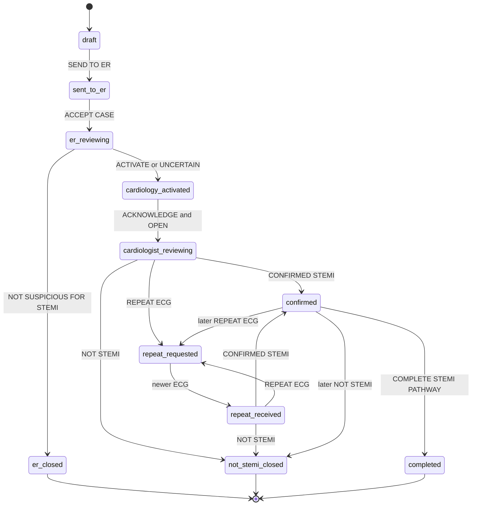

# Clinical workflow · the STEMI pathway as implemented (0.7.0)

> **PROTOTYPE · FICTIONAL TEST DATA ONLY.** This describes what the prototype does, and nothing more. It is not a
> validated clinical process and contains no clinical criteria or thresholds: every clinical step is a person's
> decision, and the software only checks that the decision is allowed in the case's current state. The reason lists,
> the wording and the working defaults still need clinical-governance approval ([open-decisions.md](open-decisions.md)).
> The corpuls monitor feed and the AI are simulated; clinician identification is a typed name (PROTOTYPE ONLY).

Related: [handover.md](handover.md) · [api.md](api.md) (exact actions and messages) ·
[architecture.md](architecture.md) · [corpuls-integration.md](corpuls-integration.md)

---

## 1. Scope

**In scope:** the coordination of a suspected STEMI from the ambulance crew to the ER Doctor and, only when the ER
Doctor activates cardiology, to the Cardiologist, until a STEMI decision is recorded and the STEMI pathway is closed.
One case per CAD number; every screen sees the same case, live.

**Out of scope** (belongs to other systems or later phases):

- the ICCC / CAD incident: closing the STEMI pathway **never** changes the CAD incident, and the platform never shows
  "CAD CANCELLED";
- the ePCR and the handover documentation (hospital, arrival, receiving clinician, final vital signs);
- transport, destination and ETA (ICCC);
- hospital, cath-lab and ACC screens, cath-lab activation, rosters, backup cardiologists;
- reminders and escalation (governance decisions pending).

## 2. Roles

| Role | Screen | Identification in the prototype | Does |
|---|---|---|---|
| Crew (EMT / paramedic) | Crew MDT `/crew` (tablet) | crew test login — one fictional crew member, *K. Ahmed, Paramedic*, *Ambulance 214* (PROTOTYPE ONLY) | opens the case under the CAD number, links the monitor, adds the four patient items, sends the case, follows the outcome, completes the pathway |
| ER Doctor | `/er` (desktop or tablet) | types their name at ACCEPT CASE (Free-text ER Doctor Name — PROTOTYPE ONLY) | accepts the case, reviews it, records the screening assessment |
| Cardiologist | `/cardiologist` (phone first) | types their name at ACKNOWLEDGE & OPEN (Free-text Cardiologist Name — PROTOTYPE ONLY) | acknowledges the activation, reviews the case, records decisions |
| Platform | — | audit role `system` | records automatic events: alerts shown, ECGs received, monitor connection, AI analysis, closures |
| Test console | `/control` | TEST ONLY device session | simulator, demo cases, reset; never a clinical action |

## 3. The pathway, step by step

### 3.1 Crew

1. **OPEN STEMI PATHWAY**, then the **CAD number** from the dispatch / MDT information. Accepted forms:
   `CAD#20261004-0123-1`, `cad # 20261004-0123-1`, extra spaces, `2026100401231`; stored as `20261004-0123-1`, shown
   as `CAD #20261004-0123-1`. An invalid number is refused with the reason. A number that already has a case gives
   **CASE ALREADY EXISTS** with *Correct the CAD number* or **OPEN EXISTING CASE**: a second case is never created.
2. **LINK CORPULS** creates the case on the platform, still **unsent** (state DRAFT, invisible to the ER and the
   Cardiologist), and links it to the unit's corpuls monitor. Until SEND the CAD number can still be corrected: the case
   and what corpuls already sent move to the corrected number. An unsent case can be discarded (nothing reached the
   ER; the case is kept as an unsent draft and can be taken up again).
3. **The monitor data arrives by itself**: the vital signs (HR, SpO₂, non-invasive BP with its own measurement time, RR)
   and the 12-lead ECG 1. In the prototype both come from the simulated feed.
4. **The crew enters four items** the monitor cannot know: age (or estimated, or unknown), sex, presenting complaint,
   symptom onset.
5. **SEND TO ER.** The server requires an ECG on the case (from corpuls or the manual fallback). The crew screen also
   requires a valid CAD number and the four items before it enables SEND. The crew does not confirm the vital signs:
   the latest monitor values travel with the case automatically and are recorded with their time. The ER is alerted;
   **the Cardiologist is not alerted at this stage**.
6. **After SEND** the crew follows the status (pathway progress CREW → ER → CARDIOLOGY → DECISION) and acknowledges
   each outcome — the ER's outcome and each Cardiologist decision — with no sound. It can still add a treatment update,
   a minimum-data correction or a manual fallback ECG; these reach the ER and the Cardiologist silently.
7. **COMPLETE STEMI PATHWAY** — only while the current Cardiologist decision is CONFIRMED STEMI, after a confirmation
   (*"COMPLETE STEMI PATHWAY? This will close the STEMI pathway for: CAD #… The STEMI case will remain available as
   read-only."*). Nothing is filled in.

### 3.2 ER Doctor

1. **NEW STEMI CASE** alert band and alarm on every ER screen, from the moment the case arrives until an ER Doctor
   accepts it.
2. **ACCEPT CASE → enter your name → ACCEPT CASE.** The first ER Doctor to accept is recorded with the time; a later
   acceptance changes nothing. The alarm stops.
3. **Review**: the original ECGs (each with source and acquisition time), the latest monitor values with their time,
   the crew's data, the AI decision support, the timeline.
4. **The ER assessment — a screening decision, not a STEMI diagnosis.** It must name the latest ECG (enforced by the
   server); the screen also requires that the latest ECG was opened first.
   - **ACTIVATE CARDIOLOGIST** — cardiology is activated at once; the same case goes to the Cardiologist queue with an
     alarm there.
   - **UNCERTAIN — ACTIVATE CARDIOLOGIST** — activates at once; recorded as *ER Assessment: UNCERTAIN, Cardiology:
     ACTIVATED*.
   - **NOT SUSPICIOUS FOR STEMI** — needs a reason from the list below (OTHER needs an explanation; a comment is
     optional otherwise). It closes the STEMI screening pathway. The Cardiologist is never notified and no cardiologist
     decision is created. The crew sees **ER REVIEW COMPLETED / CARDIOLOGY NOT ACTIVATED** — never "NOT STEMI".

   | Reason key | Reason (as recorded) |
   |---|---|
   | `criteria` | ECG DOES NOT MEET STEMI CRITERIA |
   | `alternative` | ALTERNATIVE DIAGNOSIS SUSPECTED |
   | `not-acute` | ECG CHANGES NOT CONSISTENT WITH ACUTE STEMI |
   | `clinical` | CLINICAL PRESENTATION NOT CONSISTENT WITH STEMI |
   | `quality` | POOR ECG QUALITY — NOT DIAGNOSTIC |
   | `other` | OTHER (explanation required) |

   This list is the one specified for the prototype; it needs clinical-governance approval (ER-2).

### 3.3 Cardiologist

1. **NEW CARDIOLOGY ACTIVATION** covers the screen with the alarm (CAD number, patient basics, the ER Doctor, the ER
   assessment, when cardiology was activated). Only ER-activated cases ever reach this screen.
2. **ACKNOWLEDGE & OPEN → enter your name → ACKNOWLEDGE & OPEN.** The alarm stops. Acknowledging is not a decision.
3. **Review**: the ER line, the original ECG first, the monitor values, the clinical details, the AI decision support,
   the timeline.
4. **Decisions** — each names the latest ECG (server), after it was opened (screen), confirmed in two steps on the
   screen. Every decision is kept; the latest one sets the state.
   - **CONFIRMED STEMI** (optional note to the crew, optional AI feedback) — the case stays active; the crew can
     COMPLETE.
   - **NOT STEMI** (reason required) — the decision is stored, then the STEMI pathway **closes automatically** as a
     separate event: read-only, no cath-lab activation. The crew sees NOT STEMI — PATHWAY CLOSED.
   - **UNCLEAR — REPEAT ECG REQUESTED** (optional reasons, instruction, *within N min*) — the case stays active; the
     crew sees REPEAT ECG REQUESTED; COMPLETE is not available until a later CONFIRMED STEMI.
5. After ACKNOWLEDGE & OPEN the Cardiologist may record a new decision at any time while the case is open (Q-74).

### 3.4 Repeat ECG

REPEAT ECG REQUESTED → the crew acquires a new 12-lead on corpuls3 (in the prototype's demo mode: **SIMULATE REPEAT ECG
ACQUISITION** on the crew screen, PROTOTYPE ONLY, because no physical monitor is connected) → ECG 2 arrives on the same
CAD number, announced silently to the ER and the Cardiologist (never swapped in for the ECG on screen) → state REPEAT
ECG RECEIVED → the Cardiologist reviews and records the next decision on the new ECG.

## 4. States

The state is derived on the server from the stored record, never stored (`src/Masar.Domain/Pathway/`). The labels
are those the screens show (`public/shared/rules.js`).

| State value | Crew label | ER label | Cardiologist label | Entered when |
|---|---|---|---|---|
| `draft` | DRAFT — NOT SENT | — (not visible) | — (not visible) | the crew links corpuls / creates the case |
| `sent_to_er` | SENT TO ER | NEW — AWAITING ACCEPTANCE | AT ER — CARDIOLOGY NOT ACTIVATED | SEND TO ER |
| `er_reviewing` | ER DOCTOR REVIEWING | ER REVIEW IN PROGRESS | AT ER — CARDIOLOGY NOT ACTIVATED | ACCEPT CASE |
| `er_closed` (closed) | ER REVIEW COMPLETED — CARDIOLOGY NOT ACTIVATED | CARDIOLOGY NOT ACTIVATED — CLOSED | CARDIOLOGY NOT ACTIVATED | NOT SUSPICIOUS FOR STEMI |
| `cardiology_activated` | CARDIOLOGY ACTIVATED | CARDIOLOGY ACTIVATED — AWAITING CARDIOLOGIST | NEW CARDIOLOGY ACTIVATION | ACTIVATE or UNCERTAIN |
| `cardiologist_reviewing` | CARDIOLOGIST REVIEWING | CARDIOLOGIST REVIEWING | REVIEW IN PROGRESS | ACKNOWLEDGE & OPEN |
| `repeat_requested` | REPEAT ECG REQUESTED | REPEAT ECG REQUESTED | REPEAT ECG REQUESTED | decision UNCLEAR — REPEAT ECG |
| `repeat_received` | REPEAT ECG SENT — CARDIOLOGIST REVIEWING | REPEAT ECG RECEIVED — CARDIOLOGIST REVIEWING | REPEAT ECG RECEIVED — REVIEW | an ECG newer than the one the request covered arrives |
| `confirmed` | CONFIRMED STEMI | CONFIRMED STEMI | CONFIRMED STEMI | decision CONFIRMED STEMI |
| `not_stemi_closed` (closed) | NOT STEMI — PATHWAY CLOSED | NOT STEMI — PATHWAY CLOSED | NOT STEMI — PATHWAY CLOSED | decision NOT STEMI (closed automatically) |
| `completed` (closed) | STEMI PATHWAY COMPLETED | STEMI PATHWAY COMPLETED | STEMI PATHWAY COMPLETED | COMPLETE STEMI PATHWAY |

**Cases made before 0.5.0** (sent straight to the cardiologist, no ER step) are read as already cardiology-activated
and keep working as before.

## 5. Rules enforced on the server

Every rule below is checked by the server before anything is stored (`PathwayStateMachine.Guard`, the action rules in
`src/Masar.Application/Actions/ActionService.cs`, the case commands in `src/Masar.Application/Cases/CaseService.cs`).
A refused action changes nothing. The screen shows the message as given.

| Rule | Refusal message |
|---|---|
| One case per CAD number | CASE ALREADY EXISTS (the existing case is offered; nothing is created) |
| The CAD number has the expected format | *Enter a valid CAD number before continuing.* with the reason |
| The CAD number is locked once the case was sent | *The case was already sent: its CAD number is locked.* |
| A sent case cannot be discarded | *The case was already sent: it cannot be discarded.* |
| SEND needs an ECG | *An ECG is needed to send the case: wait for the ECG from corpuls, or use the manual ECG fallback.* |
| SEND needs the crew's four items (age, sex, presenting complaint, symptom onset; Unknown is an answer) — `src/Masar.Domain/Rules/MinimumDataRules.cs`, the same rule as the crew screen | *Enter the age (or an estimate), or choose Unknown.* · *Age: a whole number from 0 to 120 years.* · *Choose the sex, or Unknown.* · *Choose the presenting complaint (or the reason for the ECG).* · *Describe the presenting complaint.* · *Enter the symptom onset time, or choose Unknown.* · *The onset time cannot be in the future.* (input plausibility only, not clinical criteria) |
| The crew adds to a case only after SEND | *Send the case before adding to it.* |
| The ER acts only on a sent case | *This case has not been sent to the ER.* |
| The ER Doctor accepts before assessing | *Accept the case before recording the ER assessment.* |
| One ER assessment per case | *The ER assessment for this case is already recorded.* |
| NOT SUSPICIOUS needs a reason; OTHER needs an explanation | *Select the reason why cardiology is not activated.* · *OTHER needs an explanation: describe the reason.* |
| An assessment or decision covers the latest ECG | *The decision must name the ECG it covers.* · *ECG N has arrived since this screen was updated. Review ECG N before recording this.* |
| The clinician has opened that ECG: the ER Doctor before the ER assessment, the Cardiologist before a decision (each role's own recorded view; the screens record a view when an ECG image is shown) | *View ECG N before recording the assessment.* · *View ECG N before deciding.* |
| Nothing reaches or is recorded by the Cardiologist before activation | *Cardiology has not been activated for this case: no cardiologist action can be recorded.* |
| Acknowledgement before a decision | *Acknowledge the case before recording a decision.* |
| NOT STEMI needs a reason | *NOT STEMI needs a reason.* |
| A clinician name is given (2–80 characters, with letters) | *Enter your name.* · *Enter your full name (at least 2 characters).* · *The name is too long (at most 80 characters).* · *Enter a name that contains letters.* |
| COMPLETE only while the current decision is CONFIRMED STEMI | *COMPLETE STEMI PATHWAY is available only while the current Cardiologist decision is CONFIRMED STEMI.* |
| A closed pathway is read-only | *This STEMI pathway is closed: it is read-only.* (completing again: *This STEMI pathway is already closed: it is read-only.*) — only viewing and the crew's acknowledgements are still recorded; image uploads, corpuls links and late monitor data are refused |
| ECGs are numbered in sequence, never replaced | *The case has N ECGs: the next ECG is ECG N+1, not ECG n.* · *ECG n already has an Image i. Nothing is replaced: add it again as a new image.* · *ECG n came from corpuls: a photo is added as a new ECG with the manual ECG fallback.* |
| Each screen sees only its cases | crew: its own unit · ER: sent cases · Cardiologist: activated cases (an ER-closed case only when searched for by CAD number) |
| An action is stored once | a resend (same action id) is accepted and changes nothing |

The screens apply the same rules first, for immediate feedback (and disable the buttons until they are met); the
server is the authority. **Only the user-interface steps** stay in the screens: the two-step confirmation of
decisions and the COMPLETE confirmation dialog (they protect against an accidental tap; the action itself is checked by
the server).

## 6. The three closures

| Closure | Triggered by | `closure_reason` | `closure_source` | State | The crew sees |
|---|---|---|---|---|---|
| ER screening closure | the ER Doctor's NOT SUSPICIOUS FOR STEMI | *ER Doctor assessment: NOT SUSPICIOUS FOR STEMI* | *ER Doctor screening decision* | `er_closed` | ER REVIEW COMPLETED / CARDIOLOGY NOT ACTIVATED, with the reason |
| NOT STEMI | the Cardiologist's NOT STEMI (closed automatically after the decision is stored) | *Cardiologist decision: NOT STEMI* | *automatic following Cardiologist decision* | `not_stemi_closed` | NOT STEMI — PATHWAY CLOSED |
| Completed | the crew's COMPLETE STEMI PATHWAY after CONFIRMED STEMI | *STEMI pathway completed* | *crew* | `completed` | STEMI PATHWAY COMPLETED |

These strings are stored in existing databases and read back to derive the state: they must not be reworded without
a data migration (`src/Masar.Domain/Pathway/PathwayClosure.cs`).

On every closure: the case becomes read-only, moves to *Completed* on every screen that saw it, its corpuls feed ends
(the last values are kept), the closure time and who closed it are stored, and the audit records it with *read-only ·
the CAD incident itself is not changed*. There is no amendment workflow for closed cases in this version.

## 7. ECGs

- **Numbered by the platform across every source** — ECG 1, 2, 3 … whether it came from corpuls or the manual
  fallback. An ECG is never overwritten; each keeps its own acquisition time, images, AI analysis and review history.
- **Sources:** `corpuls` (the monitor feed; simulated in this build), `manual_fallback` (photographed or uploaded by
  the crew), none for crew photos of 0.5.0 and earlier.
- **A manual fallback ECG** is the crew's alternative when corpuls cannot deliver (connection lost, monitor not
  connecting, feed ended, no connection to the platform). It is recorded as *manual fallback* and audited (*Manual ECG
  fallback used: ECG n …*). If an ECG from corpuls took the expected number meanwhile, the fallback ECG becomes the next
  one and the audit says *stored as ECG n*.
- **Several images** of one manual ECG can be added (Image 1 is the primary); a corpuls ECG is a single digital image.
- **New ECGs arrive silently** on the ER and Cardiologist screens: announced as *NEW — ECG n received*, never swapped in
  for the ECG on screen.
- The ECG images in this build are **fictional**: synthetic 12-leads drawn by the server (marked FICTIONAL TEST DATA ·
  NOT A PATIENT) or test images; none is a validated diagnosis.

## 8. The corpuls feed in the workflow

- The case is linked to the unit's monitor when the crew confirms the CAD number; from then on every ECG and value from
  that monitor attaches to that CAD number. ECGs acquired before the link do not attach (C-2).
- One monitor serves one case at a time: linking it to a new case ends the previous case's feed, which keeps what it
  received (C-7).
- At SEND the latest monitor values travel with the case automatically, recorded with their time; the crew does not
  confirm them (C-4).
- **A lost connection never closes the pathway, cancels the case or triggers a decision.** The screens show *CORPULS
  CONNECTION LOST* / *LIVE MONITOR DATA TEMPORARILY UNAVAILABLE · Last data received hh:mm:ss*, the last values stay
  with their time, and the manual fallback becomes prominent on the crew screen.
- **Freshness is a technical indicator only**: connected but no new values for more than 3 × the expected update
  interval shows *LAST DATA RECEIVED hh:mm:ss*. No clinical threshold is set or implied (C-3).
- Closing the pathway ends the feed; data that arrives later is refused (C-8).
- In this build the feed is the **Mock Corpuls Provider — PROTOTYPE ONLY**; no real monitor or corpuls.mission is
  connected ([corpuls-integration.md](corpuls-integration.md)).

## 9. Alarms

| Alarm | Where | Starts | Stops |
|---|---|---|---|
| NEW STEMI CASE | every ER screen | the case reaches the ER screen (recorded: *NEW STEMI CASE alert shown on the ER screen · audible alarm started*) | an ER Doctor accepts the case (*… · audible alarm stopped*) |
| NEW CARDIOLOGY ACTIVATION | every Cardiologist screen | cardiology is activated (recorded: *NEW CARDIOLOGY ACTIVATION alert shown on the Cardiologist screen · audible alarm started*) | a Cardiologist acknowledges (*… · audible alarm stopped*) |

Nothing else sounds anywhere: AI results, repeat ECGs, corpuls ECGs and monitor values, connection changes, treatment
updates, decisions and closures arrive silently. **There are no reminders and no escalation**: the alarm continues on
every screen until a clinician accepts or acknowledges. Reminder and escalation rules, thresholds and recipients are
governance decisions not yet made (ER-4, Q-11, Q-15, Q-43, Q-54, Q-72). The alarm is a browser sound (PROTOTYPE
ONLY): it needs the page open and in front and one tap on the start screen; production needs an approved alerting
method ([production-gaps.md](production-gaps.md)).

## 10. AI decision support

Simulated AI Interpretation — PROTOTYPE ONLY. One analysis per ECG, started after the ECG is stored (it never delays an
alert), shown unchanged to the crew, the ER Doctor and the Cardiologist: rhythm, rate, ST elevation, reciprocal
change, other findings, comparison with the previous ECG, overall impression, confidence, with the statement *AI
interpretation is decision support. The Cardiologist makes the final STEMI decision.* The mock returns scripted
findings for the fictional test ECGs and does not read the image. The AI never activates cardiology, decides or closes
anything. If it fails, *AI interpretation unavailable* is recorded and the case carries on. The Cardiologist may give
optional feedback on the AI report (Agree · Disagree · Did not use).

## 11. Audit

Every significant event is recorded with the time, the CAD number, the person, the role and the action
(`audit_events`; [handover.md](handover.md#35-audit-model)):

- the case opened (with how the CAD number was entered), CAD number corrections, an unsent case discarded or taken up
  again;
- SEND (what was sent, the latest monitor values with their time), the server's receipt, the ER alerted;
- alerts shown and alarms stopped; acceptance with the ER Doctor's name; every assessment with its ECG, reason and
  comment; cardiology activated; acknowledgement with the Cardiologist's name; every decision with its ECG and its
  details; the AI feedback;
- every ECG received (from corpuls or the manual fallback), every additional image, the first view of each ECG per
  role, serial comparisons;
- minimum-data entries, corrections (the previous value is kept) and treatment updates;
- the corpuls link, connected, connection lost (once per outage), restored, feed ended;
- the AI analysis started and its result;
- the crew's acknowledgements of the outcomes and decisions;
- every closure; test console actions (role `test-console`).

**Never recorded in the audit trail:** heartbeats of the live link and routine monitor samples (the values are kept as
a light history instead). The audit wording is fixed and identical to the prototype's.

The server's receive time is always recorded. The tablet's own time is kept when plausible; a crew entry saved while
the tablet was offline and received later keeps both times. **Clinician names in the audit are typed names
(PROTOTYPE ONLY)** and prove nothing about identity.

## 12. Open clinical governance decisions

The prototype uses working defaults where a decision is open. None is confirmed. The full list with each default:
[open-decisions.md](open-decisions.md). In particular: the CAD number format (Q-51) and how it reaches the tablet
(Q-70); more than one STEMI patient per incident (Q-69); who the ER Doctor is and how they sign in (ER-1); the NOT
SUSPICIOUS reasons (ER-2); UNCERTAIN activating cardiology (ER-3); reminders and escalation (ER-4, Q-11, Q-15, Q-43,
Q-54, Q-72); offline acceptance (Q-71); several cases at once (Q-73); changes after a decision (Q-74); sound on the
crew tablet (Q-75); the downtime route (Q-21); showing the AI or shadow mode (Q-26); the corpuls questions C-1 to C-8.
