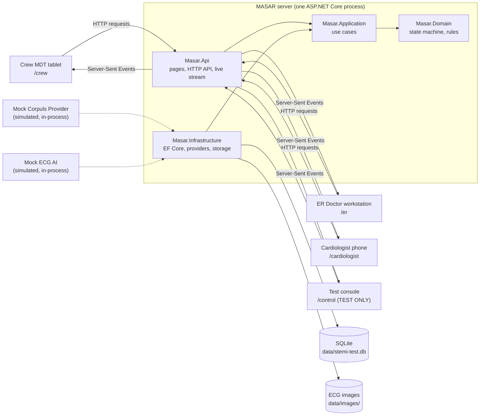
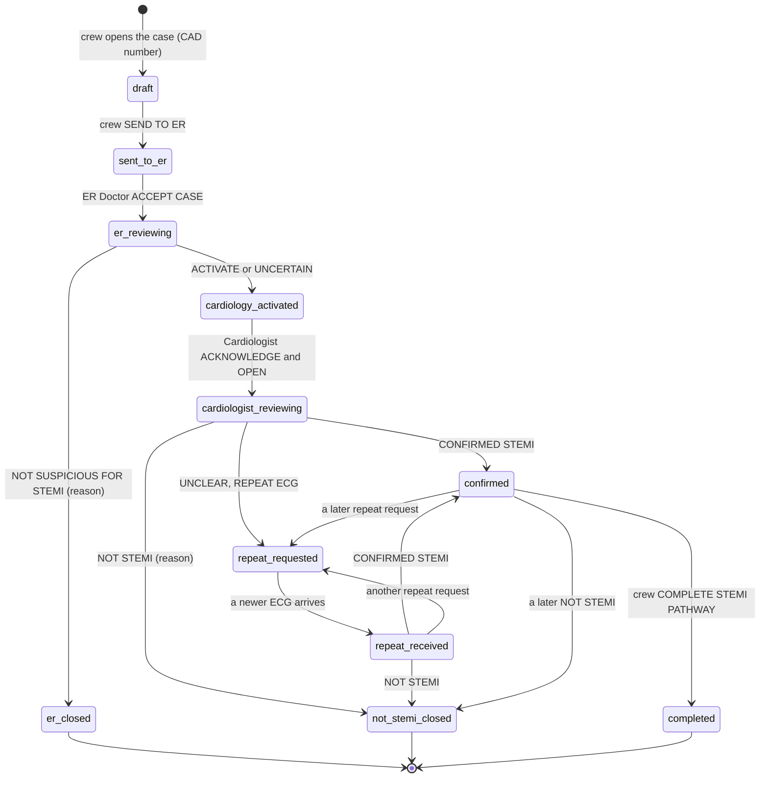

# MASAR · STEMI Coordination Platform — IT handover

**Version 0.7.0 · 20 October 2026 · prototype (test build)**

> **PROTOTYPE · FICTIONAL TEST DATA ONLY.** This repository is a working prototype of the STEMI coordination pathway.
> It runs with fictional patients, fictional CAD numbers, a **simulated** corpuls monitor feed and a **simulated** ECG
> AI. It is not approved for clinical use and must never hold real patient information. No real corpuls monitor or
> corpuls.mission environment is connected, and nothing in this repository means that National Ambulance, MEAD,
> corpuls or any hospital has approved an integration, a hosting model or a clinical rule.

This is the entry point for the National Ambulance IT Department. It describes the application as it is in this
version: what it does, how it is built, what is prototype-only, how to run, test and deploy it, and what is still open.
New to the project? Do [section 7, First day for a new developer](#7-first-day-for-a-new-developer) first.

**Contents**

- [Production readiness labels](#production-readiness-labels)
- [What changed in 0.7.0 and breaking changes](#what-changed-in-070-and-breaking-changes)
- [1. Purpose and programme](#1-purpose-and-programme)
- [2. Pathway and architecture](#2-pathway-and-architecture)
- [3. Integrations and status](#3-integrations-and-status)
- [4. Operations](#4-operations)
- [5. Open items](#5-open-items)
- [6. Who to ask: assumptions requiring confirmation](#6-who-to-ask-assumptions-requiring-confirmation)
- [7. First day for a new developer](#7-first-day-for-a-new-developer)
- [Documentation map](#documentation-map)

---

## Production readiness labels

Everything below works in the prototype and is covered by the automated tests, but it is **not production-grade**.
The label says what it is; the last column says what has to replace it before any production use.

| Component | Label | Where | Before production |
|---|---|---|---|
| Mock Corpuls Provider (simulated corpuls3 monitors, synthetic 12-lead ECGs) | **PROTOTYPE ONLY** | `src/Masar.Infrastructure/Corpuls/MockCorpulsProvider.cs`, `MockEcgRenderer.cs` | A provider for the approved corpuls.mission interface behind `ICorpulsProvider`. `RealCorpulsMissionProvider.cs` is an empty placeholder until MEAD / corpuls supply the interface ([corpuls-integration.md](corpuls-integration.md)). |
| Simulated AI Interpretation (scripted findings) | **PROTOTYPE ONLY** | `src/Masar.Infrastructure/Ai/MockEcgAiProvider.cs` | A validated and approved AI service behind `IEcgAiProvider` ([§3.4](#34-ai-status)). |
| Free-text ER Doctor Name | **PROTOTYPE ONLY** | ER Doctor's ACCEPT CASE (`er_accept`), rules in `src/Masar.Domain/Rules/ClinicianName.cs` | The name comes from the organisation's approved identity provider ([§3.3](#33-authentication-status)). |
| Free-text Cardiologist Name | **PROTOTYPE ONLY** | Cardiologist's ACKNOWLEDGE & OPEN (`ack`) | As above. |
| Crew test login (`crew@test.local`, one fictional crew user) | **PROTOTYPE ONLY** | `src/Masar.Infrastructure/Identity/CrewTestUserSeeder.cs`, `src/Masar.Api/Controllers/SessionController.cs` | Organisational sign-on with real crew identities and units. |
| Prototype device sessions (ER Doctor / Cardiologist / test console) | **PROTOTYPE ONLY** | `src/Masar.Api/Security/ScreenSessions.cs` | Authenticated users with roles from the directory. |
| Test console (`/control`) and its API (`/api/control/*`) | **TEST ONLY** | `public/control/`, `src/Masar.Api/Controllers/TestConsoleController.cs`, `src/Masar.Application/Simulation/` | Must not be deployed to production (it can delete all data and drive the simulator). |
| SQLite database (`data/stemi-test.db`) | **PROTOTYPE DATABASE** unless approved for production | `src/Masar.Infrastructure/Persistence/` | An approved database service; EF Core provider change plus migrations ([database.md](database.md)). |
| Local disk image store (`data/images/`) | **PROTOTYPE ONLY** | `src/Masar.Infrastructure/Storage/FileImageStore.cs` | Approved storage with encryption at rest, backup and a retention policy, behind `IImageStore`. |
| Local development server (`scripts/dev.js`, `npm run dev:bg`) | **DEVELOPMENT ONLY** | `scripts/dev.js`, `scripts/lib/dotnet.js` | A managed host ([deployment.md](deployment.md)). |
| In-page alarm sound (Web Audio, needs the page open and in front) | **PROTOTYPE ONLY** | `public/shared/clinical.js` | An approved alerting method with push, proof of delivery and escalation ([production-gaps.md](production-gaps.md)). |
| Fictional test ECG generator and sample ECG images | **TEST ONLY** | `public/shared/ecg.js`, `samples/` | Not part of a production system. |
| Legacy Node.js server (`server/`) | **LEGACY, transition only** | `server/`, `npm run start:legacy`, `npm run dev -- --legacy` | Removed once every developer machine runs the ASP.NET Core backend. Do not develop in it. |

---

## What changed in 0.7.0 and breaking changes

0.7.0 moves the backend from the Node.js prototype to **ASP.NET Core 10 (C#)**, as required for the IT handover. The
port is faithful: the screens (`public/`) are unchanged, and the HTTP API, the live events (Server-Sent Events) and the
SQLite database schema and file name are the same. Every end-to-end test suite of the prototype runs unchanged against
the new backend, and new xUnit unit and integration tests were added. The reasons and alternatives are in
[adr/0001-aspnet-core-backend.md](adr/0001-aspnet-core-backend.md).

| Change | What to do |
|---|---|
| **The .NET 10 SDK is required** to build and run the backend (the ASP.NET Core 10 runtime is enough on a server that runs a published build). | Install the .NET 10 SDK ([deployment.md](deployment.md)). Until it is installed, the development runner falls back to the LEGACY Node.js server and says so. |
| **Existing browser sessions are invalidated once.** Cookies are now ASP.NET Core authentication cookies, protected by Data Protection keys kept in `data/keys/`. | Crew: log in again. ER Doctor, Cardiologist, test console: reload the page (a new device session is issued on the first visit). |
| **The crew test password is no longer `stemi-test` by default.** No password is in the source code. | Set `TEST_USER_PASSWORD` in `.env` (development runner), or `Prototype__CrewTestUser__Password` (environment variable or `dotnet user-secrets`). If neither is set, a random password is generated once into `data/crew-test-password.txt` (never printed or logged). The stored hash is rewritten at start in the ASP.NET Core Identity format (PBKDF2); a hash written by the prototype (scrypt) is replaced automatically. |
| **Settings are standard .NET configuration keys** (`appsettings.json`, then environment variables such as `Corpuls__DemoMode`). | An existing `.env` keeps working: the development runner translates the prototype names (`CORPULS_DEMO_MODE` → `Corpuls__DemoMode`, …; table in [configuration.md](configuration.md)). `SESSION_SECRET` is no longer used. |
| **`/health` → `environment`** now reports the ASP.NET Core environment name in lower case (`development`, `production`, …) instead of `development` / `standard`. | Monitoring that compared it with `standard` must use `production`. |
| **`npm start`** runs the ASP.NET Core application (`dotnet run --project src/Masar.Api`). | The legacy server, if ever needed, is `npm run start:legacy`. |
| Messages that named old settings now name the .NET keys (for example *Corpuls:Provider = mock*). | None. |
| **Two clinical workflow rules moved from the screens to the server** (the IT handover rule "enforce clinical workflow rules on the backend"): SEND needs the crew's four items (age, sex, presenting complaint, symptom onset — Unknown is an answer), and the ER assessment / Cardiologist decision needs the latest ECG opened by that role. The screens already applied both, so nothing changes for a user; a client calling the API must now send the four items and record the view (action `viewed`) first. The legacy Node.js fallback applies the same two rules. | API clients and scripts: see [api.md](api.md) and [clinical-workflow.md](clinical-workflow.md#5-rules-enforced-on-the-server). |

**Not changed:** the screens, every API route and JSON field, every live event, the audit texts, the database file
(`data/stemi-test.db`) and its tables. An existing database created by the Node.js prototype is **adopted on the first
start without changing any data**: the missing columns are added (as the prototype did on every start), the baseline
migration is recorded as applied, and the case history is kept ([database.md](database.md)).

---

## 1. Purpose and programme

### 1.1 Project purpose

A narrow, time-critical **STEMI coordination platform**: one shared case per CAD number travels from the ambulance
crew to the ER Doctor and, only when the ER Doctor activates cardiology, to the Cardiologist, until a STEMI decision is
made and the pathway is closed. Every screen sees the same case, live.

The target data path is:

```
CORPULS 3 → corpuls.mission → STEMI PLATFORM → ER DOCTOR → CARDIOLOGIST → STEMI DECISION
```

The platform is **not** an ePCR, an ICCC / CAD replacement, a hospital EMR or a handover form. Closing the STEMI pathway
never changes the operational CAD incident, which belongs to ICCC; transport, destination and handover documentation
belong to ICCC and the ePCR.

This repository is a **prototype** ("test build"): it demonstrates and tests the workflow, the screens, the server-side
rules and the integration architecture with fictional data, so that clinical, governance, security and IT stakeholders
can decide on the production system.

### 1.2 MASAR programme structure

The repository contains the **STEMI coordination pathway prototype developed under the MASAR programme**, prepared for
handover to the National Ambulance IT Department. The repository does **not** document the structure of the MASAR
programme itself. Nothing below is known from the code; each item is **to be confirmed by the MASAR programme**:

| Topic | Status |
|---|---|
| Programme sponsor and accountable owner | To be confirmed by the MASAR programme |
| Product owner for the STEMI pathway | To be confirmed by the MASAR programme |
| Workstreams and the scope of each (for example the STEMI pathway, other pathways, integrations) | To be confirmed by the MASAR programme |
| Governance bodies and their remit (clinical governance, information security, data governance, change approval) | To be confirmed by the MASAR programme |
| Relationship with ICCC / CAD, ePCR, hospital systems and corpuls.mission | To be confirmed by the MASAR programme |
| Environments (development, test, production) and who owns each | To be confirmed by the MASAR programme and IT |
| Support and maintenance model after the handover | To be confirmed by the MASAR programme and IT |

---

## 2. Pathway and architecture

### 2.1 Current implemented pathway

```
CREW:  OPEN STEMI PATHWAY → CAD number → LINK CORPULS → CORPULS CONNECTED → ECG 1 arrives → live vital signs
       → age, sex, presenting complaint, symptom onset → SEND TO ER
ER DOCTOR:  alarm → ACCEPT CASE (types their name) → review →
            ACTIVATE CARDIOLOGIST  ·  UNCERTAIN — ACTIVATE CARDIOLOGIST  ·  NOT SUSPICIOUS FOR STEMI (reason required → closed)
CARDIOLOGIST (only if activated):  alarm → ACKNOWLEDGE & OPEN (types their name) →
            CONFIRMED STEMI  ·  NOT STEMI (reason required → closed automatically)  ·  UNCLEAR — REPEAT ECG REQUESTED
CREW:  COMPLETE STEMI PATHWAY (only after CONFIRMED STEMI → closed)  ·  a repeat ECG → the Cardiologist's next decision
```

- **Crew MDT (`/crew`)**: enters the CAD number from the dispatch / MDT information (checked and normalised; one case per
  CAD number), links the unit's corpuls monitor, adds the four items the monitor cannot know, sends the case, follows
  the status, acknowledges each outcome, completes the pathway after CONFIRMED STEMI. A manual ECG and manual vital
  signs are a fallback when corpuls cannot deliver.
- **ER Doctor (`/er`)**: the NEW STEMI CASE alarm until a doctor accepts; review of the original ECGs, the monitor values
  and the crew's data; a screening decision (not a STEMI diagnosis).
- **Cardiologist (`/cardiologist`, phone first)**: receives only ER-activated cases; NEW CARDIOLOGY ACTIVATION alarm
  until acknowledged; decides on the latest ECG; every decision is kept.
- **Test console (`/control`, TEST ONLY)**: the corpuls simulator, demo cases, simulation choices, the audit trail,
  presence of the screens, reset of the test data.

The clinical detail — every step, rule, closure and message — is in [clinical-workflow.md](clinical-workflow.md).

### 2.2 System architecture

One ASP.NET Core process serves every screen (static HTML, CSS and JavaScript), the HTTP API, the live event stream
(Server-Sent Events) and the stored ECG images, and keeps all data in one SQLite file.



The layers, the unit-of-work lock, the live link and the background processes are described in
[architecture.md](architecture.md), with system-context and sequence diagrams.

### 2.3 Technology stack

| Area | Technology | Version | Pinned in |
|---|---|---|---|
| Backend runtime | .NET (LTS) | SDK 10.0.100 or a later 10.0 feature band (`rollForward: latestFeature`); target `net10.0` | `global.json`, `Directory.Build.props` |
| Web framework | ASP.NET Core 10: MVC controllers, cookie authentication, Data Protection, static files, hosted services | 10.0 (shared framework) | — |
| Data access | Entity Framework Core with the SQLite provider (`Microsoft.EntityFrameworkCore`, `.Relational`, `.Sqlite`, `.Design`; `Microsoft.Data.Sqlite`) | 10.0.13 | `Directory.Packages.props` |
| Database | SQLite (one file) — PROTOTYPE DATABASE | bundled with Microsoft.Data.Sqlite | — |
| Password hashing | ASP.NET Core Identity `PasswordHasher<T>` (PBKDF2) | `Microsoft.Extensions.Identity.Core` 10.0.13 | `Directory.Packages.props` |
| EF Core tools | `dotnet-ef` (local tool) | 10.0.13 | `dotnet-tools.json` |
| .NET tests | xUnit, xunit.runner.visualstudio, Microsoft.NET.Test.Sdk, Microsoft.AspNetCore.Mvc.Testing, coverlet.collector | 2.9.3 · 3.1.4 · 17.14.1 · 10.0.13 · 6.0.4 | `Directory.Packages.props` |
| Screens | Plain HTML, CSS and JavaScript; no framework, no build step; fonts Public Sans and Atkinson Hyperlegible Mono (OFL), served locally | — | `public/` |
| Development runner, end-to-end harness | Node.js, standard library only (no npm dependencies) | ≥ 22.13 | `package.json` (`engines`) |
| Browser tests | Playwright with Chromium (installed globally, not a project dependency) | current | — |
| Build settings | Central Package Management, nullable reference types, warnings as errors, deterministic builds; application version 0.7.0 | — | `Directory.Build.props`, `Directory.Packages.props` |

Node.js is **not** needed to run the application: it is used only by the development runner and the end-to-end test
harness. The legacy Node.js server (`server/`) is kept only for the transition.

### 2.4 Repository structure

```
stemi-app/
├── Masar.sln                     the .NET solution: 4 application projects, 2 test projects
├── global.json                   .NET SDK pin (10.0.100, later feature bands allowed)
├── Directory.Build.props         shared build settings (net10.0, nullable, warnings as errors, version 0.7.0)
├── Directory.Packages.props      every NuGet package version, in one place
├── dotnet-tools.json             local tool manifest (dotnet-ef 10.0.13): dotnet tool restore
├── package.json                  npm scripts for the development runner and the tests (no npm dependencies)
├── .env.example                  development settings template; copy to .env (never committed)
├── src/
│   ├── Masar.Domain/             the pathway state machine, the clinical rules, the entities — no dependencies
│   │   ├── Pathway/              PathwayStates, PathwayStateMachine, CaseFacts, PathwayClosure, ActorRoles
│   │   ├── Rules/                CadNumber, ClinicianName, ErAssessmentRules, CardiologistDecisions, MinimumDataFields, TextRules
│   │   └── Entities/             one class per database table (Case, Ecg, EcgImage, Decision, AuditEvent …)
│   ├── Masar.Application/        the use cases
│   │   ├── Abstractions/         IMasarDbContext, IEcgAiProvider, IImageStore, ILiveNotifier, ISettingsStore
│   │   ├── Actions/              ActionService: the screens' clinical actions (POST /api/ops)
│   │   ├── Ai/                   AiAnalysisService
│   │   ├── Cases/                CaseService, CaseQueryService, CaseRecordBuilder, CaseVisibility, EcgImageService …
│   │   ├── Common/               PlatformGate (unit of work), AuditWriter, Actor, Transactions, JsonData …
│   │   ├── Monitoring/           the corpuls contract (ICorpulsProvider …), MonitorService, MonitorRecordReader
│   │   └── Simulation/           SimulationSettings, TestDataService (TEST ONLY)
│   ├── Masar.Infrastructure/     EF Core and SQLite, migrations, providers, file storage, the crew test user
│   │   ├── Persistence/          MasarDbContext, DatabaseInitializer, SettingsStore, Migrations/
│   │   ├── Corpuls/              MockCorpulsProvider, MockEcgRenderer (PROTOTYPE ONLY), RealCorpulsMissionProvider (placeholder)
│   │   ├── Ai/                   MockEcgAiProvider (PROTOTYPE ONLY)
│   │   ├── Storage/              FileImageStore
│   │   ├── Identity/             CrewTestUserSeeder (PROTOTYPE ONLY)
│   │   └── Configuration/        StorageOptions, AiOptions, CorpulsOptions, PrototypeOptions
│   └── Masar.Api/                the ASP.NET Core host
│       ├── Program.cs            composition root
│       ├── Controllers/          one controller per area of the HTTP API
│       ├── Contracts/            request and response bodies
│       ├── Live/                 LiveHub, LiveUpdates, HeartbeatService (Server-Sent Events)
│       ├── Security/             ScreenSessions, ActorResolver, ScreenSessionAttribute (PROTOTYPE ONLY sessions)
│       ├── Hosting/              StartupTasks, StartupBanner, AppInfo, FrontendFiles
│       ├── Configuration/        FrontendOptions, PrototypeSessionOptions, LiveOptions
│       └── appsettings*.json     default configuration; appsettings.Development.json for development
├── tests/
│   ├── Masar.UnitTests/          rules, state machine, providers, database and migrations, pathway services
│   └── Masar.IntegrationTests/   the HTTP API through the real ASP.NET Core pipeline (WebApplicationFactory)
├── public/                       the screens (published into wwwroot)
│   ├── index.html, login/        role chooser, crew login
│   ├── crew/ er/ cardiologist/ control/    one folder per screen
│   └── shared/                   ds.css (design system), ui.js, clinical.js, live.js, rules.js, cad.js, ecg.js, fonts/
├── scripts/                      development runner (dev.js), reset.js, the end-to-end test suites (*-test.js, acceptance.js, visual-qa.js)
│   └── lib/                      harness.js (end-to-end harness), dotnet.js (build / start the backend, .env name mapping)
├── samples/                      fictional sample ECG images (TEST ONLY)
├── docs/                         this documentation
├── server/                       LEGACY Node.js server (transition fallback only)
└── data/                         created at run time, never committed: database, images, keys, generated crew password
```

Run-time folders that are never committed: `data/`, `.local/` (development runner PID file and log), `scripts/out/`
(test screenshots), `bin/`, `obj/`, `.env`.

### 2.5 Frontend architecture

- **Plain HTML, CSS and JavaScript**, no framework and no build step. Each screen is one HTML page with its own script
  (`public/crew/crew.js`, `public/er/er.js`, `public/cardiologist/app.js`, `public/control/control.js`) and the shared
  modules in `public/shared/`:

  | Module | Exposes | Purpose |
  |---|---|---|
  | `ds.css` | — | the design system: tokens, components, light theme, local fonts |
  | `ui.js` | `window.UI` | escaping, the server clock, icons, status badges, dialogs, toasts, the top bar, connection status |
  | `clinical.js` | `window.CLIN` | ECG viewer, live monitor data, AI panel, patient data, clinical timeline, Case Summary, pathway progress, clinician name prompt, audible alarm |
  | `live.js` | `Live()` | the live link: the Server-Sent Events stream and `POST /api/ops` |
  | `rules.js` | `RULES` | clinician-name and free-text rules, the ER reasons, the state labels per role, the decision labels |
  | `cad.js` | `CADN` | CAD number normalisation and check |
  | `ecg.js` | `ECG` | the fictional test ECG generator used by the manual ECG fallback (TEST ONLY) |

- **Page bootstrap.** The server sends each page with `<!--APP-->` replaced by `window.APP = { role, user, version }`
  (`src/Masar.Api/Controllers/PagesController.cs`), so the page knows its role, the crew user and the version without
  an extra request. Static files are served under `/assets/` from `Frontend:RootPath` (`public/` in development,
  `wwwroot/` in a published build), revalidated on every load.
- **The browser is never the authority.** Every rule is enforced by the server. `public/shared/cad.js` and
  `public/shared/rules.js` are browser copies of the C# rules, kept only for instant feedback. **Keep them in step**:
  `cad.js` ↔ `src/Masar.Domain/Rules/CadNumber.cs`; `rules.js` ↔ `ClinicianName.cs`, `TextRules.cs`,
  `ErAssessmentRules.cs`, `CardiologistDecisions.cs`, and the state labels ↔ `PathwayStates.cs`.
- **Browser storage.** The crew tablet keeps its unsent case and the actions waiting to be sent in `localStorage`
  (`stemi.crew.v2`) and sends them when the connection returns (each action carries an id, so a resend is harmless).
  The ER and Cardiologist screens remember in `localStorage` which ECGs were opened, and the clinician's typed name for
  the browser session in `sessionStorage`.
- **Alarms** are played by the page (Web Audio) and need one tap on the start screen (browsers block sound until then).

### 2.6 Backend architecture

A conventional layered .NET solution. References point inwards only:

| Project | Contains | Depends on |
|---|---|---|
| `Masar.Domain` | The state machine (`PathwayStateMachine`), the states, the three closures, the clinical rules, the entities. Pure C#, no framework. | — |
| `Masar.Application` | The use cases: cases (`CaseService`, `CaseQueryService`, `CaseRecordBuilder`), clinical actions (`ActionService`), the corpuls feed (`MonitorService`), the AI (`AiAnalysisService`), the audit (`AuditWriter`), the unit of work (`PlatformGate`), and the interfaces the outer layers implement. | Domain; Entity Framework Core (queries through `IMasarDbContext`) |
| `Masar.Infrastructure` | `MasarDbContext` and the migrations, `DatabaseInitializer`, the corpuls providers, the mock AI, the image store, the settings store, the crew test user. | Application, Domain |
| `Masar.Api` | ASP.NET Core: controllers, prototype sessions, the live link (SSE), pages and static files, health, startup tasks, configuration. | all of the above |

Key design points (details in [architecture.md](architecture.md)):

- **One writer at a time.** `PlatformGate` (`src/Masar.Application/Common/PlatformGate.cs`) is a reentrant lock and the
  unit of work: every change runs inside it with one database context, so ECG numbering, state checks and the corpuls
  feed always see one consistent case. At the end of each change it pushes the changed cases to the screens, before
  the HTTP answer leaves. This assumes **one server instance**.
- **Clinical rules on the server.** Every action is checked by `PathwayStateMachine.Guard` before anything is written;
  closed cases are read-only server-side.
- **Write-through data access.** Queries do not track entities; inserts are saved at once and updates use
  `ExecuteUpdate`, so each write is executed in order inside the current transaction.
- **Replaceable integrations.** The corpuls feed (`ICorpulsProvider`), the AI (`IEcgAiProvider`), the image store
  (`IImageStore`) and the live link (`ILiveNotifier`) are interfaces chosen by configuration or registration.
- **Structured logging** through `ILogger` message templates; no passwords, secrets or patient data are logged.

### 2.7 Database design

SQLite file `data/stemi-test.db` (PROTOTYPE DATABASE). The schema is the prototype's 0.6.1 schema, created by the
baseline EF Core migration `20261020075608_InitialSchema`. The full description, the migration procedure and the
adoption of a prototype database are in [database.md](database.md).

- **The CAD number is the case key**: `cases.cad` is the primary key and every case table carries `cad`.
- **All times are Unix epoch milliseconds** (UTC).
- **Nothing clinical is overwritten**: minimum-data entries, treatments, ECGs, decisions and audit entries are added as
  new rows; the current value is the latest row. A closed case is never changed.

| Table | Holds |
|---|---|
| `cases` | one row per CAD number: crew / unit, SEND times, ER step, cardiology activation, latest decision, closure, the corpuls link and its latest values (`vitals_json`) |
| `patient_details`, `observations` | the crew's minimum data (age, sex, complaint, onset; manual-fallback vital signs), every entry kept |
| `treatments` | treatment updates from the crew |
| `ecgs`, `ecg_images` | ECG 1, 2, 3 … of each case (source: corpuls, manual fallback) and their image files with SHA-256 |
| `ai_interpretations` | one (simulated) AI analysis per ECG |
| `cardiologist_alerts` | the cardiology activation alert: raised, shown, acknowledged |
| `decisions` | every Cardiologist decision (confirm · not · repeat) |
| `ecg_role_views`, `ecg_views` | first view of each ECG image per role (`ecg_views`: 0.4.0 and earlier) |
| `monitor_vitals`, `monitor_events` | a light history of the monitor values, and the feed's significant moments |
| `case_updates` | the screens' silent "NEW" list |
| `audit_events` | the audit trail (append-only) |
| `ops` | every action received from a screen, once (idempotency) |
| `settings` | key–value settings: `sim` (test console choices), `epoch` (screens' data epoch), `corpuls_sim` (simulated monitors) |
| `users` | the crew test account (PROTOTYPE ONLY) |
| `alert_followups`, `destinations`, `etas`, `arrivals`, `handovers`, `final_vitals` | kept only so databases of earlier versions open; nothing writes to them |
| `__EFMigrationsHistory` | the applied EF Core migrations |

### 2.8 State machine

The state is **derived** from the stored record (`PathwayStateMachine.DeriveState`), never stored, and every action is
checked against it (`PathwayStateMachine.Guard`) before it is stored.



After ACKNOWLEDGE & OPEN the Cardiologist may record a new decision in any open state; each decision must cover the
latest ECG, and the latest decision sets the state. The three closed states (`er_closed`, `not_stemi_closed`,
`completed`) are read-only: only viewing and the crew's acknowledgements are still recorded. The state values, labels
and refusal messages are listed in [clinical-workflow.md](clinical-workflow.md).

### 2.9 API endpoints

The complete contract (bodies, fields, status codes, messages) is in [api.md](api.md).

| Method and path | Caller | Purpose |
|---|---|---|
| `GET /`, `/login`, `/crew`, `/er`, `/cardiologist`, `/control` | browser | the screens (`/crew` needs the crew login; the others issue a prototype device session) |
| `GET /assets/{path}` | browser | the screens' static files |
| `GET /health` | anyone | liveness: status, version, port, uptime — nothing about cases, users or secrets |
| `POST /api/login`, `POST /api/logout` | crew | crew test login (PROTOTYPE ONLY) |
| `GET /api/ping`, `GET /api/me`, `GET /api/info` | any screen | server time; own session; server information |
| `GET /api/stream?role=` | any screen | the live link (Server-Sent Events) |
| `POST /api/ops` | crew, ER, Cardiologist | clinical actions, in batches |
| `GET /api/cases/check`, `POST /api/cases`, `POST /api/cases/open`, `/correct`, `/discard`, `/complete` | crew | the case under a CAD number |
| `GET /api/cases?q=`, `GET /api/cases/view?cad=` | every role allowed | completed cases; one case read-only |
| `POST /api/images` | crew | upload a manual-fallback ECG image (JPEG / PNG) |
| `GET /files/{id}` | any session | a stored ECG image |
| `POST /api/corpuls/link`, `POST /api/corpuls/demo-acquire` | crew | link the unit's monitor; simulated repeat acquisition (demo mode, PROTOTYPE ONLY) |
| `GET/POST /api/control/*` | test console | TEST ONLY: simulator, simulation choices, demo case, screens, reset |

### 2.10 Realtime communication

- **Down: Server-Sent Events** on `GET /api/stream?role=…` (`src/Masar.Api/Controllers/LiveStreamController.cs`). On
  connecting a screen receives `init` (server clock, data epoch, role), `cfg` (the test console's simulation choices)
  and `cases` (every open case it may see); the test console also gets `presence`. Afterwards: `case` (the whole record
  of one changed case, or `rec: null` when it leaves the screen), `monitor` (new monitor values of a case the screen
  holds), `hb` (heartbeat, every `Live:HeartbeatMs`, default 5 s), `cfg`, and for the test console `corpuls` and
  `presence`.
- **Up: HTTP.** Actions are posted to `POST /api/ops` with a unique id each; other commands use their own endpoints.
- **Who receives what** is decided on the server (`src/Masar.Application/Cases/CaseVisibility.cs`): the crew sees its
  own unit's cases, the ER every sent case, the Cardiologist only activated cases, the test console everything.
- **Delivery after commit.** The pushes are made at the end of the change that caused them, while the unit-of-work lock
  is still held, so a screen never sees a half-made change; they are queued before the HTTP answer of that change is
  sent.
- **Connection state.** A screen shows CONNECTION LOST when no event (heartbeat included) arrives for 12 s or a request
  fails, and reconnects by itself; the crew tablet keeps its work locally meanwhile.

---

## 3. Integrations and status

### 3.1 Corpuls integration architecture

```
corpuls monitor ─► (corpuls.mission) ─► ICorpulsProvider ─► normalized events ─► MonitorService ─► case record ─► screens
```

- **The contract** (`src/Masar.Application/Monitoring/CorpulsContract.cs`): a provider links a case (CAD number) to the
  monitor of the crew's unit (`ConnectCase`), follows a corrected CAD number (`RelinkCase`), ends a feed
  (`DisconnectCase`) and, after a restart, carries on with the feeds that were linked (`Resume`). It reports the feed
  as three normalized events — `VitalsUpdated`, `EcgAcquired`, `ConnectionChanged` (`waiting` · `connected` ·
  `reconnecting` · `disconnected`) — each with a stable event id, so a resent event is stored once.
- **The platform side** (`src/Masar.Application/Monitoring/MonitorService.cs`, the `ICorpulsEventSink`): checks every
  event (the CAD number exists, the case is open, the monitor is the one linked to it), stores each ECG once and numbers
  it (ECG 1, 2, 3 … across every source), keeps the latest values and a light history, audits only the significant
  moments, schedules the AI analysis and pushes the change. A lost connection never closes, cancels or decides anything.
- **Selection:** `Corpuls:Provider` = `mock` (simulated) or `corpuls-mission` (placeholder, not implemented).
- **Simulator (TEST ONLY):** `ICorpulsSimulator`, implemented only by the mock provider, drives the test console's
  CORPULS SIMULATOR and the crew's simulated repeat acquisition in demo mode. It must never exist in a production
  provider.

Everything about the feed, the demo mode and the information still needed is in
[corpuls-integration.md](corpuls-integration.md).

### 3.2 Mock versus real integration status

| Integration | Status in 0.7.0 | What exists | What is needed |
|---|---|---|---|
| corpuls monitor / corpuls.mission | **Simulated only** (Mock Corpuls Provider — PROTOTYPE ONLY) | provider interface, normalized events, platform-side rules, the simulated provider, a placeholder real provider that makes no network call | the interface and approvals listed in [§5.3](#53-pending-vendor-information) |
| ECG AI | **Simulated only** (Simulated AI Interpretation — PROTOTYPE ONLY) | `IEcgAiProvider`, one analysis per ECG, failure handling | a validated, approved AI service ([§3.4](#34-ai-status)) |
| Identity provider (SSO) | **Not integrated** | prototype crew login and device sessions | an approved identity provider and its configuration ([§3.3](#33-authentication-status)) |
| ICCC / CAD | **Not integrated** | the crew types the CAD number; format and duplicates checked | governance decision Q-70 and an approved interface |
| ePCR, hospital systems | **Not integrated** | — | out of scope of this prototype |
| Push notifications / alerting service | **Not integrated** | in-page alarm sound | an approved alerting method ([production-gaps.md](production-gaps.md)) |

The application makes **no outbound network call** of any kind.

### 3.3 Authentication status

**PROTOTYPE ONLY — not secure authentication and no identity assurance.** Implemented in
`src/Masar.Api/Security/` with standard ASP.NET Core cookie authentication:

| Who | How | Cookie |
|---|---|---|
| Crew MDT | e-mail and password of the single fictional crew test user (`crew@test.local`); password from configuration or the generated file | `stemi_sid`, 24 h (`Sessions:CrewSessionHours`) |
| ER Doctor, Cardiologist, test console | no login: opening the page issues a prototype device session for that role; the clinician **types their name** at ACCEPT CASE / ACKNOWLEDGE & OPEN | `stemi_dev_er`, `stemi_dev_cardiologist`, `stemi_dev_control`, 30 days (`Sessions:DeviceSessionDays`) |

Cookies are HttpOnly, SameSite=Lax, and protected by ASP.NET Core Data Protection with keys in `data/keys/` (stored
unencrypted in the prototype: the start-up log warns about it). Each request names its screen (`X-Stemi-Role` header,
or `?role=` on the event stream); the server accepts it only with that role's session.

A typed name proves nothing: anyone with the page can type any name. **Production identity must come from the
organisation's approved authentication** — for example Microsoft Entra ID through OpenID Connect, with staff ID and
directory roles, badge or PIN at the point of care where policy requires it. The application services depend only on
the `Actor` (role, id, name, unit) that `ActorResolver` establishes, so the change is confined to
`src/Masar.Api/Security/` and the login page. See [security.md](security.md).

### 3.4 AI status

**Simulated AI Interpretation — PROTOTYPE ONLY.** `MockEcgAiProvider` returns scripted findings for the fictional
test ECG patterns. It is not a clinical model, it does not read the ECG image, and no ECG or data is sent to any
external service. One analysis per ECG is made in the background (it never delays an alert), stored once and shown
unchanged on every screen as decision support only: it never activates cardiology, decides or closes anything. When
the AI fails or is unavailable, "AI interpretation unavailable" is recorded and the case carries on.

A real AI service needs clinical validation, a staged introduction (retrospective validation, shadow mode, controlled
visibility, monitored pilot), version tracking, performance monitoring, the regulatory review required by the
approving bodies, InfoSec and data-protection approval for any data transfer, and an implementation of
`IEcgAiProvider` (`src/Masar.Application/Abstractions/IEcgAiProvider.cs`). The result fields are in
[api.md](api.md#ai-result).

### 3.5 Audit model

- **`audit_events`** is the audit trail: time, CAD number, actor (the crew user, or the name a clinician typed —
  PROTOTYPE ONLY), user id, role (`crew`, `er`, `cardiologist`, `system` for the platform / AI / corpuls feed,
  `test-console`), action text, kind (`key` pathway events, `evt` technical events, `view` viewing) and the prototype
  device session. Rows are only inserted and never reworded or deleted (except by the test console's TEST ONLY
  "delete all test data"). One exception changes a column: when the crew corrects the CAD number of a case that was
  never sent, all its rows — audit rows included — move to the corrected number, and the correction is itself audited.
- **What is audited:** case creation and CAD corrections, SEND and what was sent, alarms shown and stopped, acceptance,
  every assessment, activation, acknowledgement, decision and closure, every ECG received (and from where), the manual
  fallback, the corpuls link and its connection lost / restored / ended, the AI analysis start and result, views of ECG
  images, treatment and minimum-data updates, the crew's acknowledgements, test console actions.
- **What is never audited:** heartbeats and routine monitor samples (they would bury the clinical events). The monitor
  values are kept in `monitor_vitals` as a light history instead.
- **Supporting records:** `ops` keeps every action received from a screen once, with its payload and both times
  (device and server); `case_updates` is the screens' "NEW" list; `monitor_events` is the feed's timeline.
- **Times:** the server's receive time is always recorded. A device time is kept when plausible (not more than 48 h old,
  not more than 60 s in the future); a crew entry received more than 5 s after it was saved on the tablet keeps both
  times in its audit text.
- The audit texts are fixed wording, kept word for word from the prototype; changing one changes the record.
- **Retention, protection against alteration and export** are not implemented: governance decisions
  ([production-gaps.md](production-gaps.md)).

### 3.6 Security assumptions

The prototype is safe to demonstrate only under these assumptions; each is a production gap
([security.md](security.md), [production-gaps.md](production-gaps.md)):

- Only fictional test data is ever entered.
- It runs on a trusted local network or a developer machine, over plain HTTP (HTTPS is required for anything else).
- The test console is reachable by anyone who can open `/control`; in the prototype that is accepted.
- Clinician identification is a typed name; the crew login is one shared test account.
- Every ER screen sees every sent case and every Cardiologist screen every activation; any session can open any stored
  ECG image by its id (random, 48 bits).
- The data folder (database, images, Data Protection keys, generated password) is on the server's local disk,
  unencrypted, with no backup.
- No secret is in the source code; the crew test password comes from configuration or is generated into the data
  folder; nothing secret is logged or shown by `/health`.
- One server instance (the unit-of-work lock is in-process).

---

## 4. Operations

### 4.1 Configuration variables

Standard .NET configuration: `src/Masar.Api/appsettings.json`, then `appsettings.{Environment}.json`, then environment
variables (`Section__Key`), then command-line arguments. The full reference, with the legacy `.env` names, is in
[configuration.md](configuration.md).

| Key | Default | Purpose |
|---|---|---|
| `Kestrel:Endpoints:Http:Url` | `http://0.0.0.0:3000` | where the server listens (development runner: `PORT`, `HOST`) |
| `Frontend:RootPath` | `wwwroot` (development: `../../public`) | the screens' folder |
| `Storage:DataDirectory` | `data` (development: `../../data`) | database, images, Data Protection keys, generated password |
| `Storage:DatabaseFileName` | `stemi-test.db` | the SQLite file |
| `Storage:MaxImageBytes` | `8388608` | largest uploaded ECG image |
| `Sessions:CrewSessionHours` / `Sessions:DeviceSessionDays` | `24` / `30` | prototype session lifetimes |
| `Sessions:RequireSecureCookies` | `false` | `true` marks the session cookies `Secure` (HTTPS only): required in production, also behind a TLS-terminating proxy |
| `Live:HeartbeatMs` / `Live:OfflineAfterMs` | `5000` / `8000` | live-link heartbeat; when a role counts as offline |
| `Ai:Provider` / `Ai:MockDelayMs` | `mock` / `5000` | AI provider (only `mock`); simulated processing time |
| `Corpuls:Provider` | `mock` | `mock` (simulated) or `corpuls-mission` (not implemented) |
| `Corpuls:SimTickMs`, `SimNibpSeconds`, `SimConnectMs` | `5000`, `120`, `800` | simulated monitor timing (simulation settings, not clinical ones) |
| `Corpuls:DemoMode`, `DemoEcgSeconds` | `true`, `3` | the prototype demonstration mode and its automatic ECG 1 delay |
| `Prototype:CrewTestUser:Email` / `Password` | `crew@test.local` / none | crew test account; the password only from configuration or the generated file |
| `Logging:LogLevel:*` | `Information`, `Warning` for ASP.NET Core and EF Core | log levels |

### 4.2 Local development

1. Install the **.NET 10 SDK** and **Node.js 22** (≥ 22.13).
2. `cp .env.example .env` and adjust if needed (for example `TEST_USER_PASSWORD`, or leave it unset and read the
   generated password from `data/crew-test-password.txt`).
3. `npm run dev:bg` — builds the backend, starts the server in the background (ASP.NET Core `Development`
   environment) on port 3000, and rebuilds / restarts it when a backend file changes. `npm run dev:status`,
   `npm run dev:restart`, `npm run dev:stop`. Log: `.local/stemi-dev.log`.
4. Open `http://localhost:3000/` (role chooser), `/crew`, `/er`, `/control`; the iPhone uses
   `http://<computer's IP>:3000/cardiologist` on the same Wi-Fi.
5. Changes to `public/` need only a browser refresh; C# changes rebuild and restart automatically.

Without the development runner: `dotnet run --project src/Masar.Api` (Development environment from
`Properties/launchSettings.json`). The database is created and migrated on start; there is no manual setup step.
`npm run reset` (server stopped) deletes the test database and images; while the server runs, use the test console's
*Delete all test data*. Never use either on anything but fictional test data.

### 4.3 Production deployment considerations

The deployment procedure for a test environment is in [deployment.md](deployment.md) (`dotnet publish` produces a
self-contained folder with the screens in `wwwroot`). Before any production use:

- **Approvals first**: hosting, InfoSec, data protection, clinical safety; no real patient data before them.
- **HTTPS** with managed certificates; secure-only cookies (`Sessions:RequireSecureCookies = true`); HSTS.
- **Identity** from the approved organisational provider; remove the crew test login and the device sessions.
- **Remove the test console** (`/control`, `/api/control/*`, `Masar.Application/Simulation/`) and the simulated
  providers from the production configuration.
- **Database**: an approved database service with encryption, backups and point-in-time recovery; EF Core provider
  change and migrations ([database.md](database.md)).
- **Images**: approved encrypted storage with retention and backup.
- **Data Protection keys** protected at rest (for example a certificate or a key vault) and shared if there is more
  than one instance.
- **One instance only** as built: running several instances needs a shared lock or a single-writer design and a shared
  live-link backplane ([architecture.md](architecture.md)).
- **Alerting**, **central logging and monitoring**, **audit retention and protection**: see
  [production-gaps.md](production-gaps.md).

### 4.4 Test commands

Full description in [testing.md](testing.md).

| Command | What it runs |
|---|---|
| `dotnet test Masar.sln` (`npm run test:unit`) | xUnit: domain rules and state machine, providers, database and migrations (clean database and adoption of a prototype database), pathway services, the HTTP API through the real pipeline |
| `npm run test:api` | the server's rules through the HTTP API (no browser) |
| `npm run test:demo`, `test:corpuls`, `test:acceptance`, `test:pathway`, `test:cad` | end-to-end browser suites (Playwright + Chromium) |
| `npm run test:visual` | screenshots of every major screen at desktop, tablet and phone sizes, with layout and accessibility checks |
| `npm test` | the unit and integration tests, then every end-to-end suite except the visual one |

The end-to-end suites build the backend, start their own server on a random port with a temporary data folder and a
random crew password, and never touch the development server or `data/`. `STEMI_BACKEND=node` runs them against the
legacy Node.js server.

---

## 5. Open items

### 5.1 Known limitations

- **Simulated integrations:** the corpuls feed and the AI are simulations; there is no CAD, ePCR, hospital or
  identity-provider integration.
- **Identity:** a typed clinician name and one crew test account (see [§3.3](#33-authentication-status)).
- **Alarms** are browser sounds: they need the page open, in front, screen on and one tap first. No reminders and no
  escalation.
- **Authorisation is coarse:** every ER screen sees every sent case, every Cardiologist screen every activation; one
  crew unit (Ambulance 214); any session can open any stored image by id.
- **One server instance** (in-process lock and live link); SQLite file on local disk; no backup.
- **Plain HTTP**; Data Protection keys unencrypted at rest.
- **The CAD number** is checked for format (`YYYYMMDD-NNNN-N`) and duplicates, not against dispatch.
- **No amendment workflow** for closed cases; no retention or archive policy; the audit trail is not protected against
  alteration at database level.
- **Monitor data freshness** is a technical indicator only (3 × the expected update interval); no clinical threshold.
- ECGs acquired on a monitor before the case was linked do not attach to the case.

### 5.2 Pending governance decisions

Each open question has a working default in the build; none is confirmed. Full list with the defaults:
[open-decisions.md](open-decisions.md).

| Area | Open decisions |
|---|---|
| CAD number and incidents | Q-51 CAD number format · Q-69 more than one STEMI patient per incident · Q-70 how the CAD number reaches the tablet |
| ER Doctor step | ER-1 who the ER Doctor is and how they sign in · ER-2 the NOT SUSPICIOUS reasons · ER-3 UNCERTAIN activates · ER-4 reminders / escalation |
| Cardiologist and alerting | Q-11, Q-43 who is alerted and escalation level 1 · Q-15, Q-54 thresholds · Q-71 offline acceptance · Q-72 reminders · Q-59 lock-screen content · Q-33 personal or managed phones |
| Workflow | Q-73 several new cases · Q-74 changes after a decision · Q-75 crew sound · Q-21 downtime route and number · Q-22 destination and ETA (out of scope) · Q-56 pick lists |
| AI | Q-26 show the AI or run it in shadow mode first |
| corpuls | C-1 … C-8: linking, ECGs before the link, data freshness, confirming vital signs at SEND, which values come from the monitor, the manual fallback, one monitor and two cases, closing and the feed |
| Design | the screen designs and wording listed under "Design choices not yet confirmed" in [open-decisions.md](open-decisions.md) |
| Records | retention periods, amendment of closed cases, audit export |

### 5.3 Pending vendor information

From **MEAD / corpuls** before a real corpuls.mission provider can be written ([corpuls-integration.md](corpuls-integration.md)):
authentication method; endpoint / API documentation; ECG payload format; vital-signs payload format and units; event /
webhook mechanism (push or poll, ordering, delivery guarantees, resend); how a CAD number maps to a mission and a
monitor; device and unit identifiers; sandbox / test access and test devices; data-retention behaviour; connection,
retry and heartbeat requirements; clock synchronisation; security and data-protection approvals.

From an **AI vendor** (if one is chosen): the validated model, its intended use and regulatory status, interface,
hosting and data-transfer arrangements, performance evidence, versioning.

From the **identity provider owner** (for example the Microsoft Entra ID tenant): application registration, roles and
groups, staff identifiers, sign-in policy (MFA, badge / PIN at the point of care).

### 5.4 Future development roadmap

A proposed order of work for the IT team. **Not approved:** priorities are for the MASAR programme and governance to
set.

1. **Continuous integration:** build, `dotnet test` and the end-to-end suites on every change (the commands exist; no
   pipeline is configured in the repository).
2. **Production identity:** OpenID Connect sign-in with the approved provider; roles from the directory; remove the
   crew test login and device sessions.
3. **Separate test-only features** from the production build (test console, simulator, demo mode).
4. **Approved database and image storage**, backups, retention; migrate with EF Core.
5. **Alerting** with push, proof of delivery and escalation (governance thresholds first).
6. **corpuls.mission provider** once the interface, sandbox and approvals exist.
7. **Image authorisation:** serve a stored ECG image only to a session allowed to see its case.
8. **Scale-out**, if needed: a database-level concurrency design instead of the in-process lock, a shared Data
   Protection key ring and a live-link backplane (for example SignalR with a backplane).
9. **Retire the legacy Node.js server** (`server/`, the `--legacy` option and `STEMI_BACKEND=node`).

---

## 6. Who to ask: assumptions requiring confirmation

| Party | Needed from them | What the build assumes until then |
|---|---|---|
| **MEAD** | the corpuls.mission interface details and access, together with corpuls (list in [§5.3](#53-pending-vendor-information)) | a simulated feed; one simulated corpuls3 per unit; the case is linked when the crew confirms the CAD number |
| **Corpuls** | API documentation, payload formats and units, sandbox and test devices, delivery guarantees, clock synchronisation | the normalized events of `CorpulsContract.cs`; no vendor detail is assumed |
| **Hospitals** | participating EDs, cardiology on-call arrangements, who receives alerts, their identity provider, data-sharing agreements | any ER screen sees every sent case; any Cardiologist screen every activation |
| **Clinical Governance** | the NOT SUSPICIOUS reason list (ER-2), UNCERTAIN behaviour (ER-3), alarm, reminder and escalation thresholds, data-freshness rules, AI use and wording, decision wording, closure rules, retention and amendment of records | the working defaults in [open-decisions.md](open-decisions.md); no clinical threshold or criterion is invented |
| **Information Security** | hosting, authentication and authorisation, encryption in transit and at rest, key management, logging and monitoring, penetration testing, data protection | prototype only: local network, HTTP, typed names, keys and data unencrypted on local disk |
| **National Ambulance IT** | environments, hosting model, database platform, CI/CD, monitoring, support model, device management (tablets, phones) | single process on one machine; SQLite; development runner |
| **MASAR programme** | programme structure, ownership, priorities, the scope of the next phase | the structure in [§1.2](#12-masar-programme-structure) is unknown and not assumed |

---

## 7. First day for a new developer

- [ ] Clone the repository; the application is in `stemi-app/`.
- [ ] Install the **.NET 10 SDK** (`dotnet --version` shows 10.0.x) and **Node.js 22** (≥ 22.13).
- [ ] `dotnet tool restore` (EF Core tools, only needed for migrations).
- [ ] `dotnet build Masar.sln` — builds with warnings as errors.
- [ ] `dotnet test Masar.sln` — unit and integration tests (temporary databases, nothing else needed).
- [ ] `cp .env.example .env`; optionally set `TEST_USER_PASSWORD`.
- [ ] `npm run dev:bg`, then `npm run dev:status`.
- [ ] Open `http://localhost:3000/` and try the pathway: crew (password from `.env` or `data/crew-test-password.txt`),
      `/er`, `/cardiologist`, `/control`.
- [ ] Install Playwright with Chromium (`npm install -g playwright && npx playwright install chromium`) and run the
      end-to-end suites (`npm run test:api`, then the browser suites; [testing.md](testing.md)).
- [ ] Read [architecture.md](architecture.md), [clinical-workflow.md](clinical-workflow.md) and [api.md](api.md).
- [ ] Keep these documents current with every major change; update the diagrams when a major component changes.

---

## Documentation map

| Document | Contents |
|---|---|
| [handover.md](handover.md) | this overview |
| [architecture.md](architecture.md) | layers, unit of work, live link, background processes, diagrams |
| [api.md](api.md) | every route, request and response, live events, actions, the case record |
| [clinical-workflow.md](clinical-workflow.md) | the pathway as implemented: roles, states, rules, closures, alarms, audit |
| [database.md](database.md) | schema, migrations, adoption of a prototype database |
| [configuration.md](configuration.md) | every setting, environment variables, legacy `.env` names |
| [deployment.md](deployment.md) | building, publishing and running the application |
| [security.md](security.md) | prototype security, controls in place, what production needs |
| [testing.md](testing.md) | the test suites and how to run them |
| [troubleshooting.md](troubleshooting.md) | common problems and fixes |
| [corpuls-integration.md](corpuls-integration.md) | the corpuls contract, the simulated provider, what is still needed |
| [open-decisions.md](open-decisions.md) | open governance questions and the working defaults |
| [production-gaps.md](production-gaps.md) | what must change before production |
| [adr/0001-aspnet-core-backend.md](adr/0001-aspnet-core-backend.md) | why the backend is ASP.NET Core |
